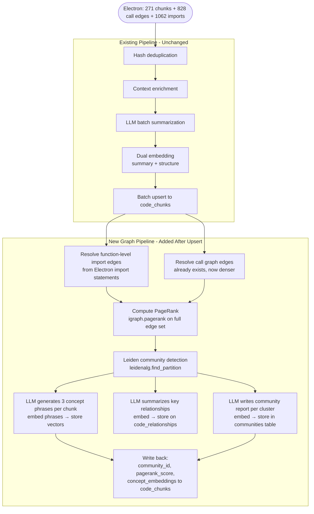
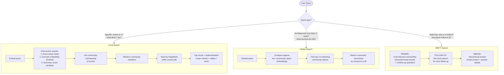

# Knowledge Graph Architecture — Code Intelligence Service

> Proposed evolution from flat vector retrieval to a multi-layer graph-aware system.
> Everything discussed, validated, and designed from first principles.

---

## Table of Contents

1. [The Problem with the Current Architecture](#1-the-problem-with-the-current-architecture)
2. [Core Concepts](#2-core-concepts)
3. [The Four-Layer Architecture](#3-the-four-layer-architecture)
4. [The Graph: Nodes, Edges, Properties](#4-the-graph-nodes-edges-properties)
5. [Index Time Pipeline](#5-index-time-pipeline)
6. [Retrieval: Three Search Paths](#6-retrieval-three-search-paths)
7. [How Each Mode Uses the Graph](#7-how-each-mode-uses-the-graph)
8. [Real Examples from chai-backend](#8-real-examples-from-chai-backend)
9. [Storage Schema](#9-storage-schema)
10. [What Changes vs. What Stays](#10-what-changes-vs-what-stays)
11. [Build Phases](#11-build-phases)
12. [Why Not LlamaIndex / Neo4j](#12-why-not-llamaindex--neo4j)

---

## 1. The Problem with the Current Architecture

The current system does **flat vector retrieval**: embed the query, find the most similar chunks, rerank, return. This works for simple lookups but breaks down on structural questions.

### Observed failures (validated against chai-backend)

**Query: "where is JWT verified before protected routes"**

Expected #1: `verifyJWT` in `auth.middleware.js`
Actual #1: `video.routes.js` — a file that merely *uses* `verifyJWT`

`verifyJWT` ranked **#12 at 85%**. Twelve route files all scored 100% because they contain the words "jwt", "protected", and "routes" in their text. The middleware that *actually does the verification* lost to files that just call it.

**Why this happens:** Vector similarity measures textual closeness. It has no concept of *structural importance* — it cannot distinguish "this chunk IS the thing" from "this chunk USES the thing".

### Root cause

The current retrieval answers every query with the same strategy:
> "Which chunks are textually most similar to this query?"

But different queries need different answers:
- FIND → "Which node in the graph IS this concept?"
- BUG → "Which execution path caused this symptom?"
- ASK → "What is the architecture of this subsystem?"
- OPTIMIZE → "What are the highest-leverage nodes in this flow?"

None of these are text similarity questions. They are **graph questions**.

---

## 2. Core Concepts

### PageRank — the "importance by connections" score

Originally invented by Google to rank web pages: *a page is important if many important pages link to it.*

Applied to code: *a function is important if many other functions call it or import it.*

```
loginUser          → calls → generateAccessandRefreshToken   ↑ 4 incoming
registerUser       → calls → generateAccessandRefreshToken
googleLogin        → calls → generateAccessandRefreshToken
refreshAccessToken → calls → generateAccessandRefreshToken

video.routes    → imports → verifyJWT   ↑ 6 incoming
user.routes     → imports → verifyJWT
like.routes     → imports → verifyJWT
tweet.routes    → imports → verifyJWT
comment.routes  → imports → verifyJWT
dashboard.routes→ imports → verifyJWT
```

Result of PageRank:
| Function | Incoming edges | PageRank |
|---|---|---|
| `verifyJWT` | 6 | **High** — it IS the implementation |
| `generateAccessandRefreshToken` | 4 | **High** — it IS the implementation |
| `video.routes` | 0 | Low — it just uses things |
| `loginUser` | 1 | Medium |

**Personalized PageRank:** Give chunks whose name/signature matches the query a 10× starting boost, then let relevance flow outward through the graph. The implementation floats to #1 automatically.

### Community Detection (Leiden Algorithm)

The Leiden algorithm finds **clusters of densely connected nodes** — functions that call each other a lot, grouped together as a "subsystem".

In chai-backend this would naturally produce:
- **Auth community**: `verifyJWT`, `generateAccessandRefreshToken`, `loginUser`, `registerUser`, `refreshAccessToken`, `logoutUser`, `user.model.js`, all route guards
- **Video upload community**: `publishAVideo`, Cloudinary utility, `video.model.js`, `video.routes.js`, frontend upload components
- **Frontend auth community**: `AuthContext`, `AuthProvider`, `ProtectedRoute`, `Login.jsx`, `Register.jsx`

Each community gets an **LLM-generated report** — a plain-English description of what the entire subsystem does, its entry points, its dependencies.

### Concept Embeddings — not strings, vectors

The current system has 25 fixed concept strings (`"auth"`, `"database"`, `"API"` etc.). Problem: the same concept can be phrased differently by the LLM and string matching fails.

The fix: LLM generates **3-5 free-form concept phrases** per chunk, each phrase is immediately **embedded as a vector** and stored. The strings are discarded.

```
verifyJWT → LLM phrases:
  "JWT bearer token verification"     → [0.23, 0.91, ...]
  "express authentication middleware" → [0.67, 0.34, ...]
  "protected route access control"    → [0.12, 0.88, ...]

At query time:
  "where is token validated" → embed → cosine similarity → hits all three
```

Two different phrasings of the same concept are close in embedding space. The inconsistency problem disappears because matching is semantic, not lexical.

The 25 fixed concepts are **kept as well** — they give fast exact matching as a first pass. Concept embeddings give semantic depth as a second pass.

---

## 3. The Four-Layer Architecture

```
┌─────────────────────────────────────────────────────────────────────┐
│  LAYER 4: COMMUNITY REPORTS                                          │
│  "What is this subsystem?"                                           │
│  Auth Community: "Handles all JWT auth flows, token generation..."   │
│  Video Community: "Manages video CRUD, Cloudinary uploads..."        │
│  Each community → LLM summary → embedded as vector                  │
└───────────────────────────────────┬─────────────────────────────────┘
                                    │ member_of
┌───────────────────────────────────▼─────────────────────────────────┐
│  LAYER 3: RELATIONSHIP EMBEDDINGS                                    │
│  "How do things connect?"                                            │
│  loginUser → calls → generateAccessandRefreshToken                  │
│  "loginUser depends on generateAccessandRefreshToken to produce      │
│   authentication tokens after credential validation"                 │
│  That description → embedded as vector                               │
└───────────────────────────────────┬─────────────────────────────────┘
                                    │ connects
┌───────────────────────────────────▼─────────────────────────────────┐
│  LAYER 2: NODE EMBEDDINGS (Chunks)                                   │
│  "What does this function do?"                                       │
│  • summary_embedding  — semantic meaning of the code                 │
│  • structure_embedding — name + file + signature                     │
│  • concept_embeddings  — 3 semantic concept vectors (NEW)            │
│  • pagerank_score      — structural importance (NEW)                 │
│  • community_id        — which cluster it belongs to (NEW)           │
└───────────────────────────────────┬─────────────────────────────────┘
                                    │ contains
┌───────────────────────────────────▼─────────────────────────────────┐
│  LAYER 1: TEXT UNITS (Raw Code)                                      │
│  "What is the raw content?"                                          │
│  • code_body — the actual implementation                             │
│  • context_header — imports and file context                         │
│  Already indexed, no change needed                                   │
└─────────────────────────────────────────────────────────────────────┘
```

---

## 4. The Graph: Nodes, Edges, Properties

### Node types

```
FILE NODE
  id, file_path, language
  community_id, pagerank_score
  summary_embedding, concept_embeddings[]

FUNCTION NODE
  id, name, signature, file_path, start_line, end_line
  community_id, pagerank_score
  summary_embedding, structure_embedding, concept_embeddings[]
  summary_code, summary_purpose
  concepts[] (fixed vocab, kept for compatibility)

CLASS NODE
  same as function node
```

### Edge types (current + new)

| Edge type | Exists now | New |
|---|---|---|
| `calls` | ✓ (sparse) | Denser with import resolution |
| `imports` (file-level) | ✓ | — |
| `imports` (function-level) | ✗ | **NEW** — per-function import edges |
| `parent_of` / `child_of` | ✓ | — |
| `inherits` / `implements` | ✓ | — |
| `sibling_next` | ✓ | — |

### The critical new edge: function-level imports

**Old:** `auth.middleware.js` → imports → `user.controller.js` (file-to-file, useless)

**New:** `verifyJWT` ← imported_by ← `video.routes.js`
         `verifyJWT` ← imported_by ← `user.routes.js`
         `verifyJWT` ← imported_by ← `like.routes.js`
         ... (6 edges total)

This is what gives `verifyJWT` 6 incoming edges and a high PageRank score. Without this, the graph is too sparse to be useful.

**Boundedness rule:** Only project-internal imports. Everything from `node_modules` is ignored. In chai-backend: `chai-backend-main/src/` files only.

### Edge properties

Each edge stores:
```
from_chunk_id, to_chunk_id, relationship_type
relationship_summary  (NEW) — "verifyJWT is imported by video.routes to protect upload endpoints"
relationship_embedding (NEW) — vector of the summary above
```

Relationship embeddings enable a powerful new retrieval: **"find the connection between these two concepts"** — useful for BUG mode where the bug lives in the relationship between two functions.

### Graph density comparison

| | Current | New |
|---|---|---|
| Nodes | 271 chunks | 271 chunks (same) |
| Call edges | ~100 (sparse, many dropped) | ~200 (better resolution) |
| Import edges | File-level only | **Function-level: ~800+** |
| Total edges | ~150 | **~1000+** |
| Average node degree | ~1.1 | **~7.4** |

A graph with average degree 1.1 is almost useless for traversal — most nodes have no connections. At 7.4, community detection and PageRank become meaningful.

---

## 5. Index Time Pipeline



### Index time cost breakdown

| Step | Cost | Frequency |
|---|---|---|
| Existing pipeline | Same as now | Every ingest |
| Import edge resolution | ~0ms (pure Python set ops) | Every ingest |
| PageRank computation | ~50ms for 271 nodes | Every ingest |
| Leiden clustering | ~100ms for 271 nodes | Every ingest |
| Concept phrase generation | 1 LLM call per 8 chunks — adds to existing summarization batch | First index only, then hash-deduped |
| Relationship summaries | 1 LLM call for top-50 edges (not all 1000) | First index only |
| Community report generation | 1 LLM call per community (est. 8-12 communities) | When community membership changes |
| All writeback | 1 batch upsert | Every ingest |

**Total added latency per ingest: ~200ms + a few extra LLM batches on first index.** Subsequent ingests are fast because hash deduplication skips unchanged chunks.

---

## 6. Retrieval: Three Search Paths



### Local Search — detailed flow

```
Query: "where is JWT verified"

Step 1 — Find anchor:
  exact name match: none for "jwt" + "verified"
  concept embedding: query embeds → close to "JWT bearer token verification" 
                     → hits verifyJWT's concept vector → anchor = verifyJWT ✓

Step 2 — Community scope:
  verifyJWT.community_id = "auth-cluster-01"
  Retrieve all 18 chunks in auth-cluster-01

Step 3 — PageRank within community:
  verifyJWT         pagerank=0.34  (6 incoming import edges)
  auth.middleware   pagerank=0.28  (contains verifyJWT)
  user.routes       pagerank=0.12  (imports verifyJWT)
  loginUser         pagerank=0.09
  ...

Step 4 — Return:
  #1  verifyJWT          0.34  ← "this IS JWT verification"
  #2  auth.middleware     0.28  ← "file containing it"
  #3  user.routes         0.12  ← "uses it for user routes"
  ...

No more route files at 100%. No more verifyJWT at #12.
```

### Global Search — detailed flow

```
Query: "how does authentication work in this app"

Step 1 — Community report retrieval:
  Embed query → compare against 8 community report embeddings
  Top match: "auth-cluster-01" report:
    "This cluster handles all authentication flows. Entry point is verifyJWT
     middleware used by 6 route files. Token generation is handled by
     generateAccessandRefreshToken (user.controller.js) which calls
     generateAccessToken and generateRefreshToken on the user model.
     Google OAuth is supported via google.controller.js. Frontend auth
     state is managed separately in AuthContext."

Step 2 — Return:
  Community report as context (architectural overview)
  + Top 5 member chunks by PageRank (specific implementations)
  
Result: LLM gets a pre-written architectural summary + key implementations.
        No need to synthesize architecture from 15 fragmented function chunks.
```

### DRIFT Search — detailed flow

```
Query: "why does the token refresh cause logout sometimes"

PRIMER phase:
  Find relevant communities: "auth-cluster-01" matches
  Community report gives context about the auth subsystem
  LLM generates:
    Broad answer: "Token refresh involves refreshAccessToken which validates
                   the existing refresh token, generates new tokens via
                   generateAccessandRefreshToken, and updates the DB."
    Follow-up 1: "How does refreshAccessToken validate the existing token?"
    Follow-up 2: "What happens if generateAccessandRefreshToken fails?"
    Follow-up 3: "How are cookies cleared on logout vs token refresh?"

FOLLOW-UP phase (local search per question):
  Q1 → anchor: refreshAccessToken → neighbors: verifyJWT, user model
  Q2 → anchor: generateAccessandRefreshToken → relationships: DB write, error paths
  Q3 → anchor: logoutUser → relationships: cookie clearing, DB token removal

MERGE:
  Top-level: broad answer about the refresh flow
  Sub-answers: specific code paths for each follow-up
  
Result: complete causal chain, not just the top 5 similar chunks.
```

---

## 7. How Each Mode Uses the Graph

### FIND mode

**Goal:** Locate the exact implementation of a named concept.

**Strategy:** Local search + personalized PageRank

**Graph's role:**
- PageRank distinguishes **implementer** (high in-degree, high rank) from **caller** (low in-degree, low rank)
- Community scoping eliminates noise from unrelated subsystems
- Relationship embeddings surface "X is used by Y" as structured output (not just text)

**Before graph:**
```
Query: "where are access tokens generated"
#1  refreshAccessToken     (wrong — refreshes, doesn't generate)
#12 generateAccessToken    (buried under route files and middleware)
```

**After graph:**
```
Query: "where are access tokens generated"
#1  generateAccessToken    pagerank=0.41 (called by 4 functions)
#2  generateAccessandRefreshToken  pagerank=0.38 (called by 3 callers)
#3  loginUser              pagerank=0.14 (calls the above)
Label: #1 and #2 are "implementations", #3 is "caller"
```

---

### BUG mode

**Goal:** Find the root cause of a reported issue, not just related code.

**Strategy:** DRIFT search + execution path traversal

**Graph's role:**
- Bugs propagate along call edges — the graph is literally the causal model
- Relationship embeddings find "X depends on Y" connections that text search misses
- Community scoping ensures you search the right subsystem, not the whole codebase
- Backwards traversal (callers of callers) surfaces the symptom-to-root-cause chain

**Before graph:**
```
Query: "login fails after refresh token expires"
Returns: loginUser, refreshAccessToken, verifyJWT (isolated, no causal chain)
LLM has to guess how they relate.
```

**After graph:**
```
Query: "login fails after refresh token expires"

Anchor: loginUser (matches "login")
Backwards traversal:
  loginUser → calls → generateAccessandRefreshToken
  generateAccessandRefreshToken → writes → User.refreshToken (DB)
  refreshAccessToken → reads → User.refreshToken (same DB field)
  
Causal chain surfaced:
  loginUser sets refreshToken → refreshAccessToken reads refreshToken
  → if the old token was already invalidated at logout, the read fails
  → that triggers the "invalid token" error path → user gets logged out

Graph reveals the shared state (User.refreshToken) that connects these functions.
Text similarity would never find this connection.
```

---

### ASK mode

**Goal:** Answer a broad architectural or conceptual question about the codebase.

**Strategy:** Global search → Local search cascade

**Graph's role:**
- Community reports provide **pre-synthesized architectural understanding** — the LLM doesn't need to infer architecture from 15 function chunks
- Global search scopes the answer to the right architectural domain before drilling into specifics
- Execution order from call graph lets the answer describe flows sequentially

**Before graph:**
```
Query: "how does user authentication work end to end"
Returns: 15 chunks ranked by text similarity, in random order
LLM synthesizes architecture from fragments — often misses the overall flow
```

**After graph:**
```
Query: "how does user authentication work end to end"

Global search finds: auth community report
  "Auth subsystem: Entry routes (user.routes.js) apply verifyJWT middleware.
   verifyJWT reads JWT from cookies or Authorization header, verifies with
   jwt.verify(), fetches user from DB, attaches to req.user. Token generation
   happens in generateAccessandRefreshToken which calls generateAccessToken
   (15min expiry) and generateRefreshToken (10day expiry) on the user model.
   Refresh token is stored in DB. Google OAuth is an alternative path via
   google.controller.js."

Local search adds: top 5 member chunks by PageRank for specific code references

Result: LLM gets a complete architectural narrative + exact file references.
        Answer describes the flow in order, not as disconnected pieces.
```

---

### OPTIMIZE mode

**Goal:** Find the highest-leverage optimization targets in a specific flow.

**Strategy:** Local search → subgraph extraction → centrality-based ranking

**Graph's role:**
- **Blast radius analysis**: which other functions does this chunk affect?
- **Hot path identification**: which functions appear most frequently in the execution path?
- **Shared dependency detection**: if two separate flows both call the same utility, optimizing that utility affects both

**Before graph:**
```
Query: "optimize the video upload flow"
Returns: top N video-related chunks by text similarity
No understanding of which optimizations have the widest impact
```

**After graph:**
```
Query: "optimize the video upload flow"

Subgraph extraction (BFS from publishAVideo):
  publishAVideo → calls → uploadOnCloudinary (3 calls: thumbnail, video, avatar)
  publishAVideo → calls → Video.create
  publishAVideo → uses → req.files (multer)
  uploadOnCloudinary → called_by → registerUser (also!)
  uploadOnCloudinary → called_by → updateCoverImage
  uploadOnCloudinary → called_by → updateUserAvatar

Centrality within subgraph:
  #1 uploadOnCloudinary  pagerank=0.61  (called by 5 different functions)
  #2 publishAVideo       pagerank=0.29  (entry point)
  #3 Video.create        pagerank=0.08  (leaf)

Output:
  "uploadOnCloudinary is the highest-leverage optimization target.
   It's called by 5 functions: publishAVideo (3×), registerUser (1×),
   updateCoverImage (1×), updateUserAvatar (1×). Optimizing it affects
   ALL upload operations across the codebase, not just video upload."

This is impossible to discover via text similarity alone.
```

---

## 8. Real Examples from chai-backend

### Example 1: Community structure (what Leiden would produce)

```
Community 0: Auth Backend
  verifyJWT, auth.middleware (file), generateAccessandRefreshToken,
  generateAccessToken (model method), generateRefreshToken (model method),
  loginUser, registerUser, logoutUser, refreshAccessToken,
  user.model (file), user.model-Aarush (file — low centrality, orphaned)
  
  Report: "Backend authentication subsystem. JWT generation via user model
           methods. Token management via user.controller.js. Middleware
           verifyJWT applied to 6 route files."

Community 1: Route Layer
  user.routes, video.routes, like.routes, tweet.routes, comment.routes,
  subscription.routes, playlist.routes, dashboard.routes, tweet.routes-Aarush
  
  Report: "Express route definitions applying JWT middleware selectively.
           All routes use verifyJWT from auth.middleware. tweet.routes-Aarush
           appears to be a development backup file."

Community 2: Video Operations
  publishAVideo, getVideoById, updateVideo, deleteVideo, togglePublishStatus,
  uploadOnCloudinary, video.model (file), Video.create
  
  Report: "Video CRUD operations with Cloudinary integration. Upload pipeline
           involves multer → local temp → Cloudinary. uploadOnCloudinary is
           shared with user avatar/cover image flows."

Community 3: Frontend Auth State
  AuthContext, AuthProvider, ProtectedRoute, Login, Register
  
  Report: "React authentication state management. Token storage in localStorage.
           ProtectedRoute redirects unauthenticated users. AuthContext provides
           login/logout functions to all components."

Community 4: Frontend Routing / UI
  App, AppContent, Sidebar, Header, various pages
  
  Report: "Main React application shell. AppContent defines route structure.
           Sidebar conditionally renders based on auth state."
```

### Example 2: PageRank scores (estimated)

```
verifyJWT              0.41  — imported by 6 route files
generateAccessandRefreshToken  0.38  — called by 4 controllers
uploadOnCloudinary     0.35  — called by 5 functions across the codebase
loginUser              0.19  — called by route handler
user.routes            0.08  — no incoming edges (entry point)
video.routes           0.07  — no incoming edges
tweet.routes-Aarush    0.02  — nothing imports it (backup file, orphaned)
```

**Key insight:** Backup files like `tweet.routes-Aarush.js` naturally get near-zero PageRank because nothing in the live codebase imports them. They're automatically deprioritized without any special "backup file detection" logic.

### Example 3: Relationship embedding that changes BUG mode

```
Edge: generateAccessandRefreshToken → DB write → User.refreshToken
Relationship summary:
  "generateAccessandRefreshToken updates the user's refreshToken field in the
   database after generating new tokens. If this DB write fails, the tokens
   are generated but not persisted, causing the next refresh to fail with
   an invalid token error."

Embedding of this summary → stored on the edge

Query: "refresh token fails on second use"
  → finds this relationship via embedding similarity
  → surfaces the "DB write failure" as the causal candidate
  → would not be found by any text similarity search on the chunk level
```

---

## 9. Storage Schema

### New tables

```sql
-- Community clusters produced by Leiden
CREATE TABLE communities (
  id              UUID PRIMARY KEY DEFAULT gen_random_uuid(),
  project_id      UUID REFERENCES projects(id) ON DELETE CASCADE,
  level           INT NOT NULL DEFAULT 0,  -- 0=leaf, 1=mid, 2=top
  label           TEXT,                    -- human-readable name (LLM-generated)
  summary         TEXT,                    -- full LLM community report
  summary_embedding VECTOR(1536),          -- embedded community report
  member_count    INT,
  created_at      TIMESTAMPTZ DEFAULT NOW(),
  updated_at      TIMESTAMPTZ DEFAULT NOW()
);

CREATE INDEX ON communities USING ivfflat (summary_embedding vector_cosine_ops);
CREATE INDEX ON communities (project_id, level);
```

### New columns on existing tables

```sql
-- code_chunks additions
ALTER TABLE code_chunks ADD COLUMN community_id UUID REFERENCES communities(id);
ALTER TABLE code_chunks ADD COLUMN pagerank_score FLOAT DEFAULT 0.0;
ALTER TABLE code_chunks ADD COLUMN centrality_score FLOAT DEFAULT 0.0;
-- Concept embeddings: store as 3 separate columns for simplicity
-- (avoids array-of-vectors complexity in pgvector)
ALTER TABLE code_chunks ADD COLUMN concept_embedding_1 VECTOR(1536);
ALTER TABLE code_chunks ADD COLUMN concept_embedding_2 VECTOR(1536);
ALTER TABLE code_chunks ADD COLUMN concept_embedding_3 VECTOR(1536);

CREATE INDEX ON code_chunks (community_id);
CREATE INDEX ON code_chunks (project_id, pagerank_score DESC);
CREATE INDEX ON code_chunks USING ivfflat (concept_embedding_1 vector_cosine_ops);
CREATE INDEX ON code_chunks USING ivfflat (concept_embedding_2 vector_cosine_ops);
CREATE INDEX ON code_chunks USING ivfflat (concept_embedding_3 vector_cosine_ops);

-- code_relationships additions
ALTER TABLE code_relationships ADD COLUMN relationship_summary TEXT;
ALTER TABLE code_relationships ADD COLUMN relationship_embedding VECTOR(1536);

CREATE INDEX ON code_relationships USING ivfflat (relationship_embedding vector_cosine_ops);
```

### New RPCs needed

```sql
-- Get all members of a community, ordered by PageRank
CREATE FUNCTION get_community_members(p_community_id UUID, p_limit INT)
RETURNS TABLE(...) AS $$
  SELECT * FROM code_chunks 
  WHERE community_id = p_community_id
  ORDER BY pagerank_score DESC
  LIMIT p_limit;
$$ LANGUAGE SQL;

-- Search community reports by semantic similarity
CREATE FUNCTION match_community_reports(
  query_embedding VECTOR(1536),
  filter_project_id UUID,
  match_count INT
) RETURNS TABLE(...) AS $$
  SELECT *, 1 - (summary_embedding <=> query_embedding) AS similarity
  FROM communities
  WHERE project_id = filter_project_id
  ORDER BY summary_embedding <=> query_embedding
  LIMIT match_count;
$$ LANGUAGE SQL;

-- Search by concept embeddings (any of the 3 concept vectors)
CREATE FUNCTION match_by_concept_embeddings(
  query_embedding VECTOR(1536),
  filter_project_id UUID,
  match_count INT
) RETURNS TABLE(...) AS $$
  SELECT DISTINCT ON (id) *, 
    GREATEST(
      1 - (concept_embedding_1 <=> query_embedding),
      1 - (concept_embedding_2 <=> query_embedding),
      1 - (concept_embedding_3 <=> query_embedding)
    ) AS concept_similarity
  FROM code_chunks
  WHERE project_id = filter_project_id
  ORDER BY id, concept_similarity DESC
  LIMIT match_count;
$$ LANGUAGE SQL;
```

---

## 10. What Changes vs. What Stays

### Stays exactly the same
- Supabase + pgvector as the database
- FastAPI service structure
- Electron parser (already emits imports and call graph)
- LiteLLM for all LLM calls
- Dual embeddings (summary + structure) on chunks
- Mode config system (FIND/BUG/ASK/OPTIMIZE)
- Pipeline versioning and A/B testing
- TTL cache
- Feedback tracking
- Authentication and all routes

### Changes in the index pipeline
- `index_worker.py` — after upsert, run import graph resolution → PageRank → Leiden → write back
- `graph.py` — import graph construction in addition to call graph
- `context_builder.py` — pass community context to summarizer
- `summarizer.py` — extend batch prompt to also generate 3 concept phrases per chunk, embed them

### Changes in retrieval
- `search.py` — three search path functions: `_local_search()`, `_global_search()`, `_drift_search()`
- `mode_router.py` — each mode mapped to a primary search path
- `queries.py` — new RPCs: community report retrieval, concept embedding search, PageRank-ordered community member retrieval

### New files
- `app/services/graph_builder.py` — import graph construction + PageRank + Leiden using `igraph`
- `app/services/community.py` — community report generation and caching
- `app/routes/community.py` — optional: `GET /api/communities/{project_id}` for debugging

### New dependencies
```
igraph>=0.11        # graph data structure + PageRank
leidenalg>=0.10     # Leiden community detection
```
No Neo4j. No LlamaIndex. No new infrastructure.

---

## 11. Build Phases

### Phase 1: Dense Import Graph + PageRank (1 week)
**What:** Resolve function-level import edges from Electron's import statements. Compute PageRank. Store on chunks.

**Impact:** FIND mode gets PageRank as a ranking signal. `verifyJWT` goes from #12 to #1 on "where is JWT verified". `tweet.routes-Aarush.js` (backup file with no importers) naturally scores near zero.

**Risk:** Low. PageRank is additive — existing retrieval still runs, PageRank just adds a new score column.

### Phase 2: Leiden Community Detection + Community Reports (1 week)
**What:** Run Leiden after indexing. Generate community reports. Add community-scoped retrieval.

**Impact:** FIND and BUG modes become community-scoped — dramatically less noise. ASK mode gets architectural context from community reports.

**Risk:** Medium. Requires new Supabase table and schema migration. Community quality depends on graph density — Phase 1 must be done first.

### Phase 3: Concept Embeddings (1 week)
**What:** Extend summarizer to generate 3 concept phrases per chunk. Embed and store. Add concept embedding search to retrieval.

**Impact:** Open-ended semantic concept matching. Queries that don't match fixed vocab now work. "Token rotation", "session invalidation", "OAuth callback" all become findable.

**Risk:** Low. Additive to existing concept string matching. If concept embedding search returns nothing, falls back to fixed vocab.

### Phase 4: Relationship Embeddings + DRIFT Search (2 weeks)
**What:** Summarize and embed key relationships (top-50 edges by weight). Implement DRIFT search for BUG/ASK modes.

**Impact:** BUG mode surfaces causal chains not just related chunks. ASK mode gives architectural narratives. Multi-hop questions become answerable.

**Risk:** Medium. DRIFT adds LLM calls at query time (primer step). Need to ensure total latency stays under 120s timeout.

---

## 12. Why Not LlamaIndex / Neo4j

This question deserves a direct answer.

**LlamaIndex** is built for unstructured text documents — PDFs, articles, notes. It extracts entities like "Apple Inc" from prose. Our data is already structured: functions, call edges, line numbers, type signatures. LlamaIndex's data model fights our data model. You'd spend more time adapting than benefiting.

**Neo4j** is a purpose-built graph database with Cypher query language. It's excellent for graphs but it means: a new service to run, a new cost center, a new failure point, and a completely different query language from the PostgREST/SQL you already use. For 270-10,000 node graphs (which is our scale), **Postgres with igraph is faster and simpler**.

**The honest math:**

```
LlamaIndex + Neo4j approach:
  + Less code to write initially
  - Wrong data model
  - Loses all existing features (A/B testing, caching, mode configs, etc.)
  - New infrastructure
  - Black box — can't observe intermediate steps
  - Slower queries at runtime

igraph + Leiden + existing stack:
  + Full control
  + Keeps everything that already works
  + No new infrastructure
  + Fully observable and tunable
  + pip install igraph leidenalg
  - More code to write
```

For a product actively being tuned and improved, **full control is worth more than convenience**.

---

## Summary

The current architecture treats every query as a text similarity problem. The proposed architecture treats queries as **graph problems** that happen to use text similarity as one of several signals.

The three key additions — **dense import graph + PageRank**, **community detection + reports**, **concept embeddings** — are not replacements. They're layers on top of what already works, each adding a specific capability that the current flat retrieval fundamentally cannot provide:

| Capability | Current | Graph Architecture |
|---|---|---|
| Find the implementation vs the caller | ✗ | ✓ via PageRank |
| Answer "how does X work architecturally" | Weak | ✓ via community reports |
| Find causal chain for a bug | ✗ | ✓ via DRIFT + traversal |
| Deprioritize backup/orphaned files | ✗ | ✓ via low PageRank naturally |
| Match semantically equivalent concepts | ✗ | ✓ via concept embeddings |
| Surface highest-leverage optimization targets | ✗ | ✓ via subgraph centrality |
| Multi-hop reasoning | ✗ | ✓ via DRIFT search |
