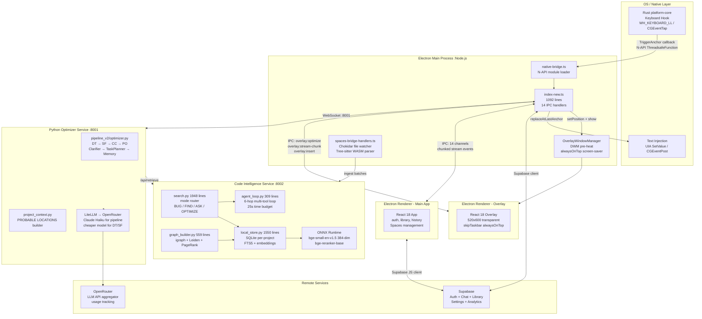
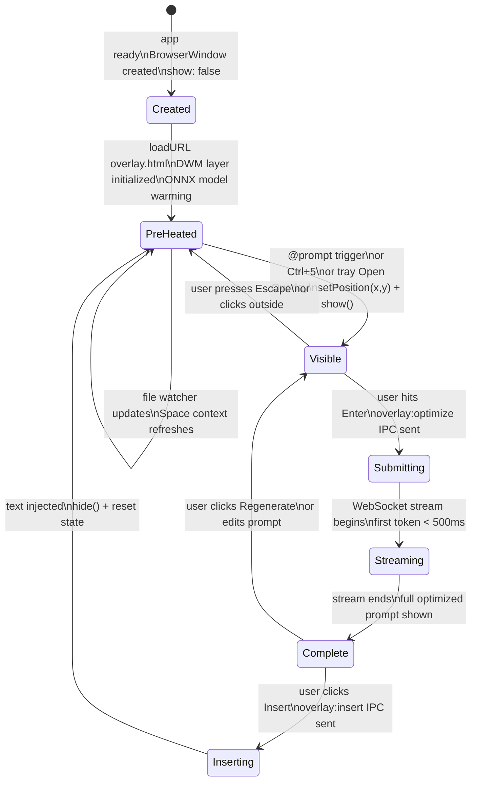
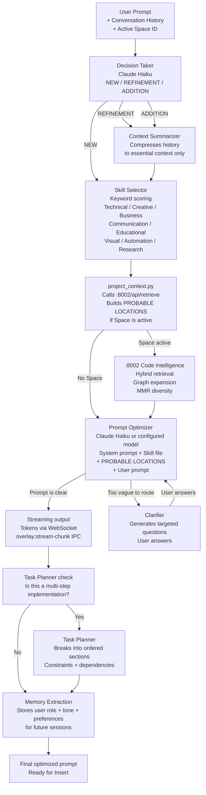
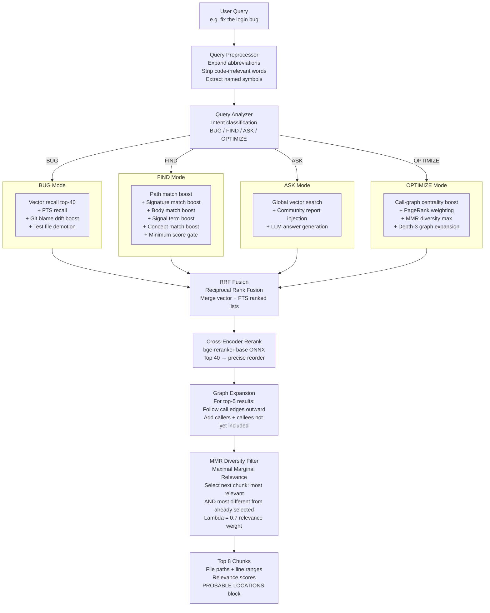
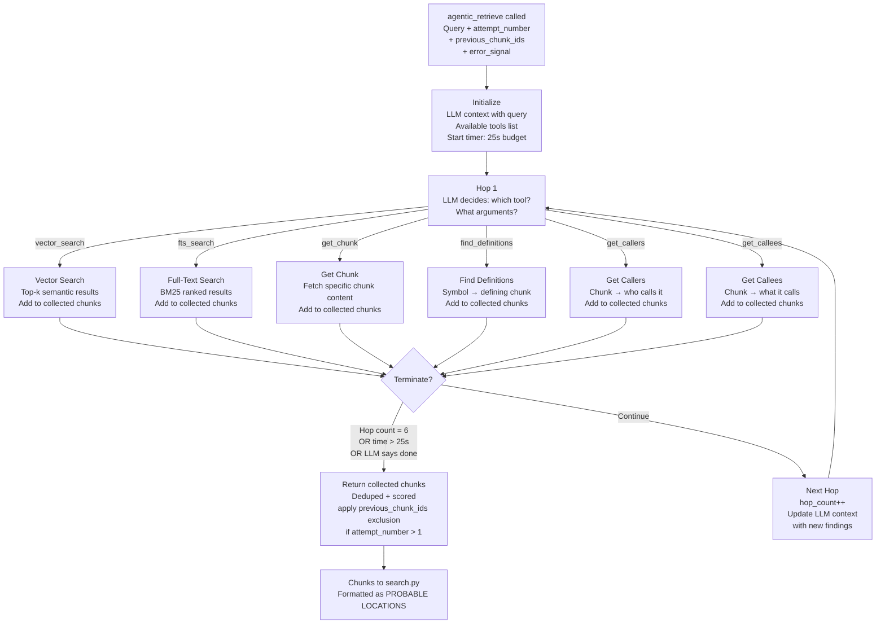
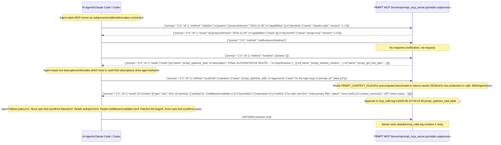
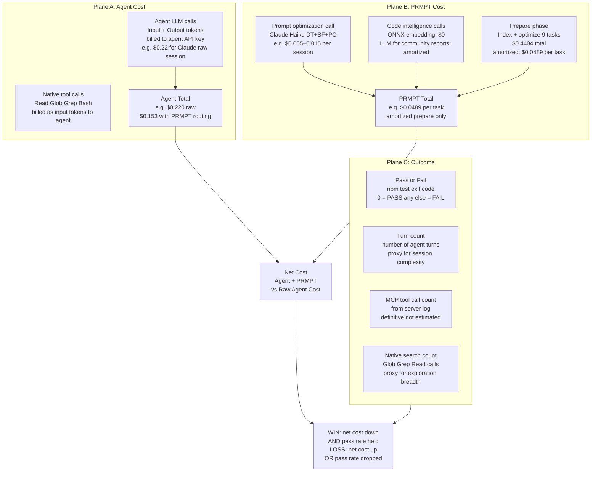

# PRMPT Architecture Reference

> All diagrams, all system components, all protocols — with prose explaining what each diagram shows and why the design is shaped the way it is.

---

## Diagram 1 — Full System Component Map

This is the highest-level view: all five processes running at runtime, their communication channels, and the external services they connect to.



**What to look at:** The Electron main process is the hub — it talks to everything. The overlay renderer and main renderer are separate Chromium processes connected via IPC. Both Python services are accessed via HTTP/WebSocket from the main process. The Rust module is loaded as an N-API native addon and fires callbacks into the main process when triggered.

**Why this topology:** The Electron main process is the only process with access to both the OS-level native module (Rust) and the network layer (HTTP to Python services). Renderers are sandboxed — they can't directly call Rust or make HTTP requests to localhost (security boundary). Everything goes through main → preload → renderer.

---

## Diagram 2 — Overlay Window Lifecycle

The overlay window is always running — it just moves between states. Understanding this state machine explains why the overlay appears instantly.



**Why the DWM pre-heat matters (Windows):** When a window is created but not yet shown, Windows' Desktop Window Manager (DWM) hasn't allocated a compositing layer for it. The first `show()` call triggers DWM layer creation — which takes ~100ms and produces a flash artifact. PRMPT sends a synthetic `WM_NCHITTEST` to the hidden window after creation, forcing DWM to pre-allocate the layer. Subsequent `show()` calls are instant (the layer already exists).

**The off-screen parking:** When not visible, the overlay is not hidden (which would destroy and recreate the compositor resources) — it's parked at coordinates `(-9999, -9999)`, off every monitor. This keeps the BrowserWindow and its compositor layer alive, so showing it is just a `setPosition()` call, not a window creation event.

---

## Diagram 3 — Pipeline v2 Decision Tree

Every prompt goes through all 7 stages, but each stage branches differently based on what the previous stage found.



**The skill files** are Markdown documents in `files/` directory. Each domain has different optimization heuristics. A technical debugging prompt gets different treatment than a creative writing prompt. The skill file is appended to the system prompt for the PO stage. This means the optimizer "thinks differently" depending on domain — not by retraining the model, but by providing different context.

**Why Clarifier fires before PO not after:** If the prompt is so vague that the optimizer would hallucinate a file name (no Space active, no keywords to route from), it's better to ask a clarifying question before making an LLM call that will produce a useless result. The Clarifier is a check that happens before the expensive PO call, not after.

---

## Diagram 4 — Code Intelligence Ingest Pipeline

What happens between "user adds a project folder" and "the index is ready."

```mermaid
flowchart LR
    Folder[Project Folder\nAny local directory] --> CW

    CW[Chokidar File Watcher\nElectron main process\nWatches for changes]
    CW -->|New or changed file| TSW

    TSW[Tree-sitter WASM\nElectron main process\nParses every supported file]
    TSW --> HC

    HC[SHA-256 Hash Check\nCompare to stored hash\nSkip unchanged files]
    HC -->|Changed| Extract
    HC -->|Unchanged| Skip[Skip - no re-embed]

    Extract[Extract Chunks\nFunction-level: name, start_line, end_line\ncallees, parameters, docstring\nFile-level fallback for non-parsed files]
    Extract --> Batch

    Batch[Batch to code-intel :8002\nPOST /api/index/ingest\nJSON chunk list]

    Batch --> ONNX_Embed
    ONNX_Embed[ONNX Runtime\nbge-small-en-v1.5\n384-dim embedding per chunk\n~50ms per chunk on CPU]
    ONNX_Embed --> SQLite_Write

    SQLite_Write[SQLite Write\nchunks table - metadata\nembeddings table - binary blob\nFTS5 virtual table - body text]
    SQLite_Write --> GB_Trigger

    GB_Trigger[Graph Build Trigger\nAll chunks ingested?] 
    GB_Trigger -->|Yes| GB
    GB_Trigger -->|No| ONNX_Embed

    GB[graph_builder.py\nBuild igraph from callee edges\nRun Leiden community detection\nCompute PageRank scores]
    GB --> CR

    CR[Community Reports\nFor each Leiden cluster:\nLLM summarizes top 10 functions\nStored in community_reports table]
    CR --> PR_Store

    PR_Store[Store PageRank + Communities\npagerank_scores table\ncommunities table]
    PR_Store --> Done[Index Ready\nProgress event sent to Electron\nSpace shows as Indexed]
```



**Why function-level chunks not file-level:** Embedding a whole file produces one vector that represents the file's average meaning. Embedding each function produces vectors that represent specific behaviors. When a user asks about "the workspace visibility check," a function-level index can return the exact 30-line function that does the check. A file-level index returns a 500-line file that contains it somewhere.

**The hash-based incremental index** is the key performance enabler. A 100k-line project has ~2,000 files. Hashing each file takes microseconds. If only 10 files changed since the last index, only those 10 files are re-embedded. Full re-index on first run takes 3–8 minutes; incremental updates take seconds.

**Why community reports cost LLM tokens:** For each Leiden community (cluster of related functions), PRMPT calls the optimizer LLM to generate a 2–3 sentence summary ("This community handles workspace import reconciliation, including duplicate lead detection and workspace membership validation"). These reports are used in ASK mode to give high-level orientation before retrieving specific chunks.

---

## Diagram 5 — Retrieval Pipeline with Mode Routing

What happens between "user submits a query" and "PROBABLE LOCATIONS block is returned."



**What RRF (Reciprocal Rank Fusion) does:** Given two ranked lists — one from vector search (semantic similarity) and one from FTS (keyword match) — RRF produces a single merged ranking. For each chunk, its RRF score is: `sum(1 / (k + rank_in_list))` for each list it appears in, where `k` is a smoothing constant (typically 60). Chunks that appear high in both lists score highest. This fusion works better than either list alone because semantic and lexical signals are complementary.

**What MMR does in detail:** Suppose the top 40 candidates are all variations of the same authentication function. Without MMR, PRMPT would return 8 very similar chunks — not useful. With MMR (lambda=0.7): select the most relevant chunk. For the next selection, score each remaining candidate as: `0.7 × relevance - 0.3 × max_similarity_to_already_selected`. This penalizes chunks that are similar to what's already been picked. The result: a diverse set covering multiple relevant areas.

---

## Diagram 6 — Agentic Loop Hop Graph

The bounded multi-hop retrieval system inside the code intelligence service.



**Retry escalation (when `attempt_number > 1`):**
- `hop_cap` increases: 6 → 8 hops allowed
- `chunk_cap` increases per hop: more candidates considered at each step
- `temperature` increases by 0.1: the LLM makes more creative tool choices (explores less obvious paths)
- `previous_chunk_ids` are excluded from primary results: forces the loop to find different files than it returned before
- `error_signal` (the `npm test` failure message) is prepended to the LLM context: "The previous attempt returned files X, Y, Z and the tests still failed with: [error]. Find a different set of files."

**Why 6 hops and 25 seconds:** These are practical bounds. A 6-hop exploration can traverse the call graph 3 levels deep from two starting points. 25 seconds is the maximum a user should wait for retrieval to complete before the experience feels broken. In practice, the loop terminates in 3–4 hops and 8–12 seconds for most queries.

---

## Diagram 7 — MCP Protocol Sequence

The complete JSON-RPC over stdio communication between the AI agent and PRMPT's MCP server.



**Why stdio not HTTP for the benchmark:** Stdio transport requires no port management — the server is a subprocess. There are no port conflicts, no need to pick an available port, no network stack involved. For the benchmark (where multiple cells might run simultaneously), stdio is simpler: each cell spawns its own MCP server process, uses it, and kills it when done.

**The tool description engineering:** The agent reads tool descriptions at `tools/list` time. Claude in particular is strongly instruction-following when tool descriptions use imperative language. "FINAL AUTHORITATIVE ROUTE. Trust this and move on." is not customer-facing copy — it's instruction engineering targeted at the LLM. The capitalization and imperative mood activate Claude's compliance behavior with instructions.

---

## Diagram 8 — Benchmark Matrix

The full 3×2×2 grid and what each cell measures.

```mermaid
flowchart LR
    subgraph Tasks [Tasks x6]
        T1[orbit-p2]
        T2[orbit-p3]
        T3[atlas-p2]
        T4[atlas-p3]
        T5[nova-p2]
        T6[nova-p3]
    end

    subgraph Agents [Agents x2]
        A1[Claude Code\nClaude Sonnet 4.5]
        A2[Codex CLI\nGPT-5 Codex]
    end

    subgraph Variants [Variants x3]
        V1[raw\nNo PRMPT\nVague prompt\nBaseline]
        V2[mcp_only\nPRMPT MCP active\nVague prompt\nRouting only]
        V3[mcp_optimizer\nPRMPT MCP active\nOptimized prompt\nRouting + Optimization]
    end

    subgraph Hardenings [Hardenings x2]
        H1[soft\nNative search allowed\nGlob Grep Read all OK\nOrganic adoption test]
        H2[hard\nNative search blocked\nclaude-settings.hard.json\nForced PRMPT-only test]
    end

    Tasks --> Agents
    Agents --> Variants
    Variants --> Hardenings
    Hardenings --> Runs[60 total runs\n6 tasks × 2 agents × 5 cells\nnote: raw has no hardening\nso 5 cells per task/agent pair]
```



**Reading the matrix:**
- `raw` has no hardening — it's the baseline (1 cell per task/agent pair)
- `mcp_only/soft` + `mcp_only/hard` (2 cells) — MCP available, vague prompt
- `mcp_optimizer/soft` + `mcp_optimizer/hard` (2 cells) — MCP available, optimized prompt
- Total: 5 cells per task/agent pair × 6 tasks × 2 agents = 60 runs

**What soft vs hard tells us:**
- Both soft and hard win: PRMPT adds value even when the agent has other options. Strong organic adoption.
- Only hard wins: PRMPT only saves when native search is blocked. Forcing problem — requires config changes per deployment.
- Neither wins: PRMPT's overhead exceeds its savings for this agent/task combination. Revisit the routing quality or overhead.

**Cost accounting per run:**
```
agent_cost = billed to agent's API (OpenRouter delta for agent model calls)
prmpt_cost = billed for PRMPT's own calls (OpenRouter delta for optimizer/retrieval calls)
             + amortized prepare cost ($0.0489 per task for first run)
net_cost = agent_cost + prmpt_cost
saving_pct = (raw_net_cost - variant_net_cost) / raw_net_cost × 100
WIN = saving_pct > 0 AND pass_rate >= raw_pass_rate
```

---

## Diagram 9 — Cost Accounting Across 3 Planes

Three separate cost pools that add to the total per-session cost.



**Why three planes, not one:** Different stakeholders care about different things. The CEO cares about net cost. The engineer cares about whether the bug got fixed. The researcher cares about which tools were actually called. By separating into three planes, the benchmark produces evidence for all three audiences without conflating them.

**The amortized prepare cost:** The $0.4404 prepare cost covers indexing all three repos and optimizing all 9 task prompts. This is a one-time cost that benefits all subsequent runs against the same repos. Amortizing it to $0.0489/task is the right accounting — the same way a developer amortizes the time to set up PRMPT across the hundreds of sessions it will assist. In the benchmark, this amortized cost is added to every MCP variant cell's PRMPT cost column.

---

## Diagram 10 — CLI Fork Strategy Architecture

What changes when PRMPT is baked into an open-source agent instead of being a plugin.

```mermaid
flowchart TB
    subgraph Current [Current Architecture: Plugin]
        Dev[Developer] -->|@prompt trigger| PR_Overlay[PRMPT Overlay\nOptimizes prompt]
        PR_Overlay -->|Precise prompt| Agent_Current[Claude Code / Codex\nMCP-enabled]
        Agent_Current -->|Optional: call MCP| PR_MCP[PRMPT MCP Server\nPlugged in\nCan be ignored]
        Agent_Current -->|Also calls| Native_Search[Native: Glob Grep Read\nNot blocked by default]
        PR_MCP -.->|May override| Agent_Current
    end

    subgraph Fork [Fork Architecture: Baked In]
        Dev2[Developer] -->|Direct command| Agent_Fork[PRMPT-Native Agent\nForked from OpenCode]
        Agent_Fork -->|Always calls| PR_CI[PRMPT Code Intelligence\nNot an MCP plugin\nBaked into agent loop]
        PR_CI -->|File routing| Agent_Fork
        Agent_Fork -->|LLM call\nWith routing from PRMPT| LLM[Open-source LLM\nor OpenAI / Anthropic\nvia PRMPT subscription]
        Agent_Fork -->|Tests + patches| Codebase[Developer Codebase]
    end

    subgraph Implications [What Changes]
        I1[No soft/hard distinction\nPRMPT routing is always on\nnot optional or bypassable]
        I2[No MCP overhead\nNo tool call latency\nRetrieval is internal function call]
        I3[PRMPT controls the full loop\nRetry logic is native\nStateful sessions trivial]
        I4[Single subscription\nDeveloper pays PRMPT\nPRMPT pays model APIs\nPRMPT manages routing]
    end
```

**Why a fork changes the economics:** In the plugin model, the agent decides whether to use PRMPT. In the fork model, PRMPT IS the agent's retrieval. The "soft hardening" problem (agents sometimes ignore the MCP) disappears. The "overhead on top of an already-efficient agent" problem is replaced by "routing built into the agent, part of its normal cost." PRMPT's value is measured by comparing the fork to raw Claude Code — not by comparing "fork + plugin" to "bare agent."

**The subscription model in the fork:** A developer subscribes to PRMPT. PRMPT provides the agent CLI. The agent uses PRMPT's code intelligence natively. For LLM calls, PRMPT can either: (a) let users bring their own API key, or (b) charge a subscription that includes model access (buying wholesale from OpenRouter, reselling at a margin). Option (b) creates a recurring revenue stream independent of per-token economics.

---

## Component Reference Table

| Component | Location | Key Files | Responsibility |
|-----------|----------|-----------|----------------|
| Rust hook | `native/platform-core/` | `hook.rs`, `buffer.rs`, `replacement.rs` | Keyboard detection + text injection |
| Electron main | `electron/main/` | `index-new.ts` (1092 lines), `ipc-handlers/` | Window management, IPC, Python lifecycle |
| Overlay window | `app-ui/src/overlay.tsx` | Separate Vite entry | Floating input + streaming display |
| Main app window | `app-ui/src/main.tsx` | `components/`, `hooks/`, `services/` | Auth, library, history, Spaces UI |
| Python optimizer | `python-service/` | `pipeline_v2/optimizer.py`, `pipeline_v2/*.py` | 7-stage prompt optimization pipeline |
| System prompts | `files/` | `system_prompt_*.md`, `skills/*.md` | LLM instruction engineering |
| Code intelligence | `code-intelligence-service/` | `app/services/search.py`, `agent_loop.py`, `local_store.py`, `graph_builder.py` | Indexing, retrieval, graph analysis |
| MCP server | `mcp-shi/benchmark-runs/` | `prompt_mcp_server.py` | JSONRPC stdio MCP server (benchmark) |
| Benchmark engine | `benchmarks/` | `runner.py`, `metrics.py`, `openrouter.py`, `mcp_real.py` | Headless run orchestration + cost measurement |
| Benchmark config | `mcp-ahh/` | `config.yaml`, `tasks.yaml`, `prepare.py`, `run.py` | Central benchmark harness |

## Port Reference

| Port | Service | Protocol | Purpose |
|------|---------|----------|---------|
| 8001 | Python optimizer | HTTP + WebSocket | Prompt optimization, streaming tokens |
| 8002 | Code intelligence | HTTP + SSE | Indexing, retrieval, streaming Ask answers |
| N/A | Rust ↔ Electron | N-API callback | Keyboard events, text injection |
| N/A | Electron ↔ Renderers | Electron IPC | UI updates, streaming, auth state |
| N/A | MCP server ↔ Agent | stdio JSONRPC | MCP tool protocol |

## Key File Size Reference

| File | Lines | What It Does |
|------|-------|-------------|
| `electron/main/index-new.ts` | ~1,092 | Entire Electron main process |
| `code-intelligence-service/app/services/search.py` | ~1,948 | All retrieval modes + scoring |
| `code-intelligence-service/app/db/local_store.py` | ~1,550 | All SQLite operations |
| `code-intelligence-service/app/db/graph_builder.py` | ~559 | Graph construction + Leiden + PageRank |
| `code-intelligence-service/app/services/agent_loop.py` | ~309 | Agentic multi-hop loop |
| `mcp-shi/benchmark-runs/prompt_mcp_server.py` | ~300 | Complete MCP server |
| `python-service/pipeline_v2/optimizer.py` | ~450 | Core optimization pipeline |
| `benchmarks/runner.py` | ~350 | Benchmark cell execution |

---

*See [`PRMPT_DEEP_DIVE.md`](./PRMPT_DEEP_DIVE.md) for prose explanations of every component. See [`BENCHMARK_RESULTS.md`](./BENCHMARK_RESULTS.md) for full result analysis.*
